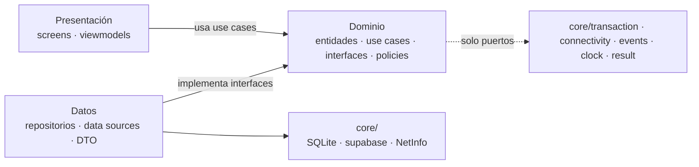
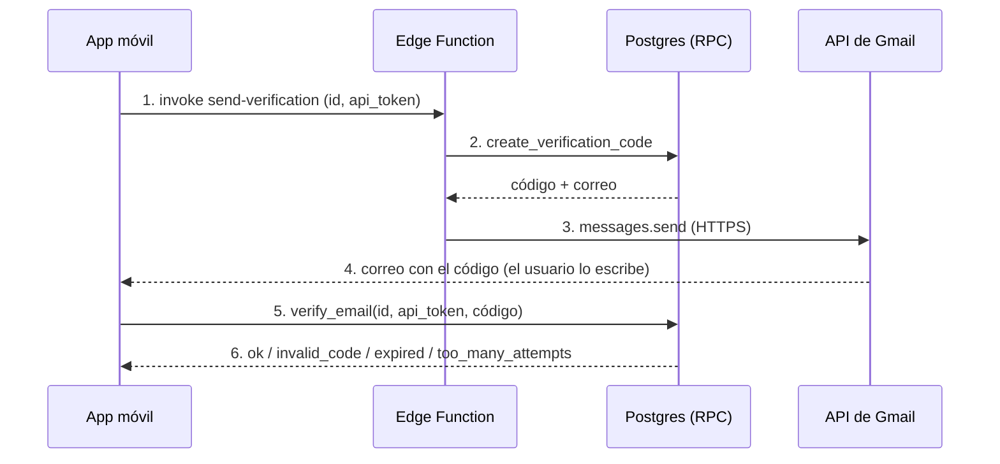
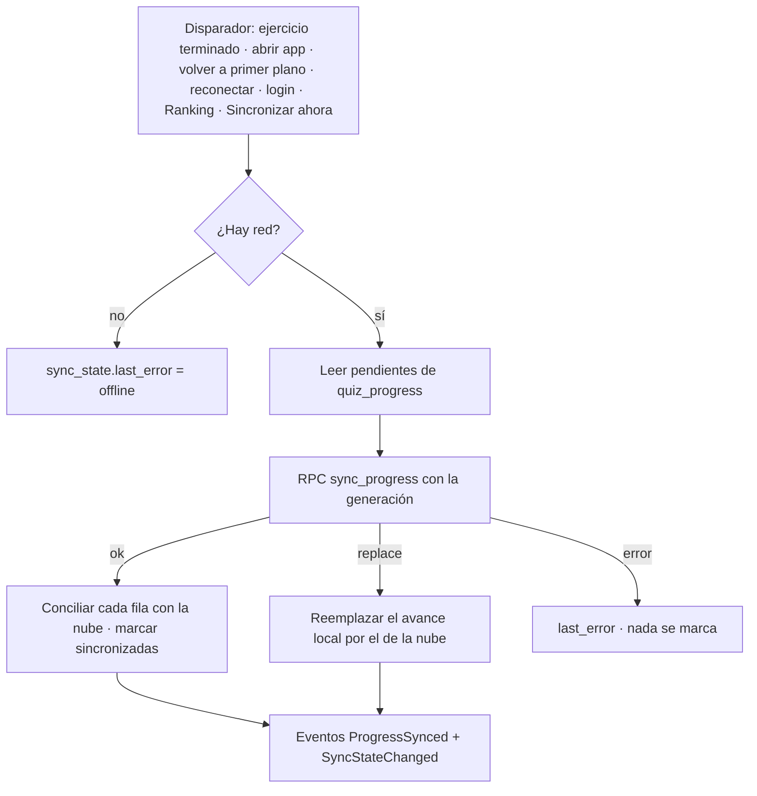

# CONTAITSCCH — Arquitectura por Features

Versión 2 (refactorización con los cambios del cliente), 16 de noviembre de 2026. Plan y decisiones:
`spec/contaitscch-refactor/PLAN.md`. Diseño de referencia: `spec/contaitscch-refactor/index.html`.

## Visión general

App para que la comunidad estudiantil del ITSCCH (Instituto Tecnológico Superior de la Costa Chica)
aprenda contabilidad desde cero: **6 niveles × 4 temas**, cada tema en 4 pasos (objetivo e infografía →
explicación → ejemplo resuelto → repaso) que termina con un **ejercicio de opción múltiple**, y un
**examen integrador** al final. Incluye glosario y ranking. No hay XP, rachas ni vidas.

La app se organiza en **features verticales**, cada una con su propia **Clean Architecture interna**
(domain → data → presentation), sobre un enfoque **offline-first**: SQLite es la fuente de verdad del
teléfono y Supabase guarda el perfil y el avance para restaurarlo en otro teléfono y armar el ranking.

Decisiones clave:

1. **Offline-first real.** Estudiar, presentar ejercicios y el examen leen y escriben solo en SQLite.
   Ninguna pantalla de estudio depende de la red.
2. **Supabase guarda el avance, no el contenido.** `profile` y `quiz_progress` (aprobado, mejor puntaje e
   intentos por ejercicio). El contenido del curso nunca sale del teléfono.
3. **Avance fusionable.** Cada teléfono sube su avance y la nube lo fusiona con reglas conmutativas e
   idempotentes: aprobar nunca se deshace, se toman el mayor puntaje y los intentos, y el `passed_at`
   más antiguo. Otro teléfono continúa donde quedó el avance sincronizado.
4. **Valores derivados, no almacenados.** Desbloqueo, nivel actual, niveles completados, progreso y
   posición en el ranking se calculan con policies puras o consultas.
5. **Features desacopladas.** Una feature solo consume la API pública (`index.ts`) de otra o reacciona a
   eventos de dominio. Las rutas de `src/app/` componen las pantallas (por ejemplo, les pasan la barra
   superior).
6. **Autenticación propia por RPC** (sin Supabase Auth): hash PBKDF2 en la app y doble hash en Postgres.

## Stack tecnológico

| Necesidad           | Librería                                                      | Por qué                                                         |
| ------------------- | ------------------------------------------------------------- | --------------------------------------------------------------- |
| Base de la app      | Expo SDK 58 + TypeScript 6 estricto                           | Builds sencillos, OTA updates, tipado fuerte                    |
| Navegación          | Expo Router (rutas tipadas)                                   | Pestañas + pantallas completas + modal                          |
| Estilos             | **Tailwind v3 vía NativeWind v4** + `tailwind-variants`       | Tokens en variables CSS: modo claro y oscuro según el sistema   |
| BD local            | `expo-sqlite` + Drizzle ORM                                   | Consultas tipadas, migraciones versionadas, transacciones       |
| API remota          | `@supabase/supabase-js` (solo `rpc()` y `functions.invoke()`) | Las tablas se acceden únicamente por funciones RPC              |
| Hash de contraseña  | `@noble/hashes` (PBKDF2-SHA256) + `expo-crypto` (sal)         | JavaScript puro: funciona en Expo Go                            |
| Contenido del curso | JSON en el bundle + Zod                                       | Validado antes de sembrar SQLite y en CI                        |
| Formularios         | React Hook Form + Zod                                         | Validaciones del registro y del acceso                          |
| Credenciales        | `expo-secure-store`                                           | Guarda `user_id` + `api_token` cifrados                         |
| Conectividad        | `@react-native-community/netinfo`                             | Saber si se puede sincronizar y reaccionar al reconectar        |
| Gráficos            | `react-native-svg`                                            | Camino curvo de la ruta de temas                                |
| Iconos              | `@expo/vector-icons` (MaterialCommunityIcons)                 | Un solo set; equivalentes de los Material Symbols del prototipo |
| Pruebas             | Jest + React Native Testing Library; pgTAP en Supabase        | Dominio, repositorios, pantallas y RPC                          |

## Estructura de carpetas

```text
src/
├── app/                          # Rutas de Expo Router (solo componen pantallas de features)
│   ├── _layout.tsx               # Fuentes, providers, guard de sesión
│   ├── (auth)/                   # registro, verificar-correo, login
│   ├── (tabs)/                   # index (Niveles), aprender, glosario, ranking, perfil
│   ├── tema/[topicId].tsx        # Lección de 4 pasos
│   ├── ejercicio/[quizId].tsx    # Ejercicio de un tema o examen integrador (900)
│   └── acerca-de.tsx             # Conoce CONTAITSCCH
│
├── composition/                  # Composition root
│   ├── bootstrap.ts              # Migraciones, siembra de contenido, sesión, contenedor y autoSync
│   ├── container.ts              # Inyección de dependencias (repos y use cases)
│   ├── autoSync.ts               # Sincroniza en segundo plano (ejercicio, primer plano, reconexión)
│   ├── RootNavigator.tsx         # Guard de sesión
│   ├── providers/                # AppProviders (useContainer), useBootstrap, useSession
│   └── testing/                  # createTestContainer (SQLite en memoria para pruebas)
│
├── core/                         # Infraestructura sin reglas de negocio
│   ├── database/                 # client, schema/ (Drizzle), migrations/, seed/ (JSON + ContentSeeder), UnitOfWork
│   ├── network/                  # supabaseClient, RpcClient (contrato), NetInfoConnectivity
│   ├── connectivity/             # Puerto Connectivity (lo usa el dominio)
│   ├── transaction/              # Puerto UnitOfWork / Tx (lo usa el dominio)
│   ├── events/                   # DomainEventBus (Observer)
│   ├── session/                  # SessionStore + SecureStore (user_id, api_token)
│   ├── clock/                    # Clock (nowIso, todayLocal) inyectable
│   └── result/                   # Result<T, E>
│
├── shared/
│   ├── ui/                       # Componentes con Tailwind (Button, Card, AppHeader, PodiumCard…)
│   ├── theme/                    # colors.js (claro/oscuro) + useThemeColors
│   ├── hooks/                    # useCountdown…
│   └── utils/                    # getInitials, timeAgo, formatNumber
│
└── features/
    ├── auth/                     # Registro, verificación, login, usuario actual
    ├── onboarding/               # Conoce CONTAITSCCH
    ├── home/                     # Pestaña Niveles (inicio)
    ├── levels/                   # Tarjetas de nivel
    ├── learning/                 # Avance del curso, ruta de temas, lección de 4 pasos
    ├── quizzes/                  # Ejercicio y examen, avance por ejercicio, sincronización, reinicio
    ├── glossary/                 # Glosario con búsqueda
    ├── leaderboard/              # Ranking con caché
    └── profile/                  # Perfil, barra superior e indicador de sincronización
```

Plantilla interna de cada feature (ejemplo con `quizzes`):

```text
features/quizzes/
├── domain/
│   ├── entities/          # Quiz, QuizProgress, Sync
│   ├── policies/          # ProgressRules (applyResult, mergeProgress, reconcile), QuizAccessPolicy
│   ├── repositories/      # Interfaces: QuizReader, QuizProgressRepository, ProgressRemote…
│   ├── usecases/          # StartQuiz, CheckAnswer, SubmitQuiz, SyncProgress, ResetProgress…
│   └── testing/           # Dobles en memoria para las pruebas
├── data/
│   ├── datasources/       # SupabaseProgressRemoteDataSource (RPC + DTO con Zod)
│   └── repositories/      # SqliteQuizRepository, SqliteQuizProgressRepository, SqliteSyncStateRepository
├── presentation/
│   ├── screens/           # QuizScreen
│   ├── components/        # QuizResultView
│   └── viewmodels/        # useQuizViewModel + quizVm (textos puros, con prueba)
└── index.ts               # API pública
```

## Capas y regla de dependencias

Las dependencias solo apuntan hacia `domain`: la UI llama casos de uso y la capa de datos implementa las
interfaces que el dominio define.



| Capa           | Contiene                                   | Puede importar                                                                                        | No puede importar                                                                |
| -------------- | ------------------------------------------ | ----------------------------------------------------------------------------------------------------- | -------------------------------------------------------------------------------- |
| `domain`       | Entidades, use cases, interfaces, policies | Puertos de `core` (transaction, connectivity, events, clock, result); `import type` de otras features | React, SQLite, Supabase, `core/database`, `core/network`, `data`, `presentation` |
| `data`         | Repositorios, data sources, mappers/DTO    | Su `domain`, `core/database`, `core/network`                                                          | `presentation`                                                                   |
| `presentation` | Screens, componentes, viewmodels           | Use cases vía `useContainer()`, `shared/ui`, `index.ts` de otras features                             | `data`, SQL, `rpc()` directo                                                     |

La regla la aplica ESLint (`no-restricted-imports` por capa): un import prohibido falla `npm run lint`.

**MVVM.** Cada pantalla tiene un hook `useXxxViewModel` (carga, acciones, navegación) y una función pura
`toXxxVm` que arma los textos, probada sin React. Las pantallas de pestaña reciben la barra superior como
prop `header`; la ruta le pasa `<AppTopBar />` (feature `profile`), así ninguna feature depende de quién
muestra la sesión y la sincronización.

## Patrones de diseño y SOLID

| Patrón                | Dónde                                                                                         | Problema que resuelve                                                 |
| --------------------- | --------------------------------------------------------------------------------------------- | --------------------------------------------------------------------- |
| Repository            | `SqliteCourseProgressRepository`, `SqliteQuizProgressRepository`, `SqliteRankingCache`…       | Ocultar si el dato viene de SQLite o de Supabase                      |
| Use Case              | `SubmitQuizUseCase`, `SyncProgressUseCase`, `GetLessonUseCase`…                               | Una acción de negocio = una clase con `execute()`                     |
| DI + Composition Root | `composition/container.ts`                                                                    | Las capas reciben interfaces; en pruebas se cambian por dobles        |
| Unit of Work          | `core/transaction/UnitOfWork` + `SqliteUnitOfWork`                                            | Guardar el avance y el estado de sincronización en una transacción    |
| Policy pura           | `CourseProgressPolicy`, `ProgressRules`, `QuizAccessPolicy`, `PodiumPolicy`, `GlossarySearch` | Reglas de negocio probables sin base de datos                         |
| Observer (Event Bus)  | `ProgressChanged`, `LevelCompleted`, `FinalExamPassed`, `ProgressSynced`, `SyncStateChanged`  | Refrescar pantallas y disparar la sincronización sin acoplar features |
| Outbox                | `quiz_progress` con `synced_at` distinto de `updated_at`                                      | Subir lo pendiente cuando haya red, sin perder datos                  |
| Mapper / DTO          | Data sources remotos (Zod), `lessonContent` del tema                                          | snake_case ↔ camelCase, validar lo que llega de fuera                 |
| Facade                | `SyncProgressUseCase`, `SyncAndFetchRankingUseCase`                                           | Una llamada para subir, fusionar, marcar y pedir el ranking           |
| MVVM                  | `useXxxViewModel` + `toXxxVm`                                                                 | Pantallas que solo pintan                                             |

SOLID: un use case por acción; policies abiertas a reglas nuevas sin tocar el flujo; repositorios
intercambiables (SQLite real o en memoria) con el mismo contrato; interfaces pequeñas
(`QuizReader` separado de `QuizProgressRepository`, `CourseProgressSource` con un solo método); y
dependencias por constructor ensambladas en el contenedor.

## Detalle por feature

| Feature       | Pantallas                              | Use cases principales                                                                                                  | Datos                                                                                                                     |
| ------------- | -------------------------------------- | ---------------------------------------------------------------------------------------------------------------------- | ------------------------------------------------------------------------------------------------------------------------- |
| `auth`        | Registro (2 pasos), VerifyEmail, Login | `RegisterUser`, `RequestVerificationCode`, `VerifyEmailCode`, `Login` (restaura el avance), `Logout`, `GetCurrentUser` | RPC `register`, `get_login_params`, `login`, `verify_email`; Edge Function `send-verification`; tabla `user`; SecureStore |
| `onboarding`  | Conoce CONTAITSCCH                     | — (contenido estático)                                                                                                 | `aboutContent.ts`                                                                                                         |
| `home`        | Niveles (inicio)                       | Compone `learning`, `levels`, `quizzes` y `auth`                                                                       | Tips en `tips.ts`                                                                                                         |
| `levels`      | Tarjetas de nivel                      | `GetLevelsOverview`                                                                                                    | `level` + avance del curso                                                                                                |
| `learning`    | Aprender (ruta), Lección de 4 pasos    | `GetCourseProgress`, `GetSyllabus`, `GetLesson`                                                                        | `level`, `topic`, `quiz_progress`; infografías                                                                            |
| `quizzes`     | Ejercicio / Examen y resultado         | `StartQuiz`, `CheckAnswer`, `SubmitQuiz`, `GetFinalExamStatus`, `SyncProgress`, `GetSyncStatus`, `ResetProgress`       | `quiz`, `question`, `question_option`, `quiz_progress`, `sync_state`; RPC `sync_progress`, `reset_progress`               |
| `glossary`    | Glosario                               | `GetGlossary`                                                                                                          | `glossary_term`                                                                                                           |
| `leaderboard` | Ranking                                | `SyncAndFetchRanking`                                                                                                  | RPC `get_ranking`; `leaderboard_cache`                                                                                    |
| `profile`     | Perfil, barra superior (`AppTopBar`)   | Compone `auth`, `levels`, `quizzes`                                                                                    | —                                                                                                                         |

Flujo central del ejercicio (`SubmitQuizUseCase`): califica con la clave de respuestas (que nunca sale a
la UI), aplica `applyResult` al avance dentro de una transacción (+1 intento, mejor puntaje, aprobar nunca
se deshace), calcula si se completó un nivel o se abrió el examen, y publica `ProgressChanged` (y
`LevelCompleted` / `FinalExamPassed`). `autoSync` escucha `ProgressChanged` y sube el avance en segundo
plano.

## Autenticación sin Supabase Auth (hash en la app)

> **Verificación de correo opcional (17 nov 2026).** Está apagada mientras se elige proveedor de correo
> (se planea Resend). Un solo interruptor en Postgres: `private.settings.email_verification_required`
> (migración `20261117000100_optional_email_verification.sql`). `register` y `login` devuelven
> `verification_required`; la sesión lo guarda y el guard usa `canEnterApp` (verificado o no requerido).
> Apagada: se entra al curso al registrarse, el ranking incluye a todos y un correo ya registrado
> siempre responde `email_taken` (nadie puede reemplazar una cuenta sin verificar). Para encenderla:
> `update private.settings set email_verification_required = true;` (no hace falta publicar la app).

La app deriva el hash con PBKDF2-SHA256 y una sal aleatoria por usuario; Supabase solo recibe y compara ese hash mediante funciones RPC llamadas con el SDK, sin usar Supabase Auth. La contraseña en texto plano nunca sale del teléfono ni se guarda en SQLite.

| Paso          | En la app                                                                                             | En Supabase (RPC vía `supabase.rpc`)                                                                                     |
| ------------- | ----------------------------------------------------------------------------------------------------- | ------------------------------------------------------------------------------------------------------------------------ |
| Registro      | Genera sal de 16 bytes (`expo-crypto`), calcula `PBKDF2(password, sal, 60 000 iteraciones, 32 bytes)` | `register(email, nombres, país, estado, ciudad, hash, sal, iteraciones)` guarda el perfil y devuelve `id` + `api_token`  |
| Enviar código | Llama `supabase.functions.invoke('send-verification')`                                                | Edge Function genera código de 6 dígitos, guarda su hash con vencimiento de 10 min y envía el correo con la API de Gmail |
| Verificar     | Envía el código escrito                                                                               | `verify_email(id, token, code)` marca `email_verified = true`; máximo 5 intentos, reenvío cada 45 s                      |
| Login         | Pide la sal, recalcula el hash con la contraseña escrita                                              | `get_login_params(email)` devuelve sal + iteraciones; `login(email, hash)` compara y devuelve `id`, `api_token` y perfil |
| Sesión        | Guarda `id` + `api_token` en SecureStore; ya no pide login, ni siquiera offline                       | Cada RPC posterior valida `id` + `api_token`                                                                             |

Tres protecciones que no cuestan nada y conviene incluir:

- **Doble hash en el servidor.** El hash de la app funciona como "la contraseña" ante el servidor. Si se guardara tal cual, quien lea la tabla podría iniciar sesión con él. Por eso Postgres guarda `digest(hash_cliente, 'sha256')` (extensión `pgcrypto`, incluida en Supabase) y compara contra eso.
- **Sin enumeración de correos.** Si el correo no existe, `get_login_params` devuelve una sal falsa pero estable (derivada del correo), y `login` responde el mismo error genérico.
- **Iteraciones guardadas por usuario.** Si más adelante se sube de 60 000 a otro valor, los usuarios antiguos siguen entrando con las suyas.

Puerto de dominio + implementación (Strategy, se puede cambiar de algoritmo sin tocar los use cases):

```ts
// features/auth/domain/ports/PasswordHasher.ts
export interface PasswordHasher {
  createSalt(): Promise<string>;
  hash(password: string, salt: string, iterations: number): Promise<string>;
}

// features/auth/data/crypto/Pbkdf2PasswordHasher.ts
import { pbkdf2Async } from '@noble/hashes/pbkdf2';
import { sha256 } from '@noble/hashes/sha256';
import { bytesToHex, hexToBytes } from '@noble/hashes/utils';
import * as Crypto from 'expo-crypto';

export class Pbkdf2PasswordHasher implements PasswordHasher {
  async createSalt() {
    return bytesToHex(await Crypto.getRandomBytesAsync(16));
  }
  async hash(password: string, salt: string, iterations: number) {
    const key = await pbkdf2Async(sha256, password.normalize('NFKC'), hexToBytes(salt),
                                  { c: iterations, dkLen: 32 }); // async: no congela la UI
    return bytesToHex(key);
  }
}

// features/auth/domain/usecases/LoginUseCase.ts
async execute({ email, password }: LoginInput): Promise<Result<Session>> {
  const params = await this.remote.getLoginParams(email.trim().toLowerCase());
  const hash = await this.hasher.hash(password, params.salt, params.iterations);
  const session = await this.remote.login(email, hash);   // supabase.rpc('login', …)
  if (!session.ok) return err('INVALID_CREDENTIALS');
  await this.sessionStore.save(session.value);            // SecureStore
  await this.restoreProgress.execute(session.value);      // sync_progress: baja el avance de la nube
  return session;
}
```

Cambios al modelo de Postgres:

```sql
create extension if not exists pgcrypto;

alter table profile
  add column password_salt       text    not null,
  add column password_iterations integer not null default 60000,
  add column email_verified      boolean not null default false,
  add column timezone            text    not null default 'America/Mexico_City';
-- password_hash ahora guarda digest(hash_de_la_app, 'sha256') en hex

create table email_verification (
  profile_id  uuid primary key references profile(id) on delete cascade,
  code_hash   text        not null,          -- sha256 del código de 6 dígitos
  expires_at  timestamptz not null,
  attempts    integer     not null default 0,
  last_sent_at timestamptz not null default now()
);

-- dentro de login(): comparación contra el doble hash
select id, api_token into v_id, v_token
from profile
where email = lower(p_email)
  and password_hash = encode(digest(p_hash, 'sha256'), 'hex');
```

Nota de rendimiento: 60 000 iteraciones en JavaScript puro tardan alrededor de un segundo en un teléfono de gama media; se muestra un indicador de carga en el botón. Si resulta lento en los equipos de prueba, se baja el valor (queda guardado por usuario).

### Envío con Gmail y código de verificación

Postgres genera el código, una Edge Function lo envía con la **API de Gmail** y Postgres lo valida. La app nunca recibe el código: solo lo conoce quien abre el correo.

> **Versión real:** el SQL y el código de esta sección son el diseño original; la Edge Function vigente está en `supabase/functions/send-verification/` (sin dependencias, Gmail o Mailpit en local). La implementación vigente está en `supabase/migrations/` y sus pruebas en `supabase/tests/`. Diferencias: todas las RPC responden con un `status` en vez de lanzar excepciones (`create_verification_code` devuelve `cooldown` con `retry_in_seconds`, `invalid_token` o `already_verified`), validan `id + api_token` con `private.is_owner`, y `verify_email` responde `ok` si el correo ya estaba verificado.



Se usa la API de Gmail (HTTPS) en lugar de SMTP porque las Edge Functions de Supabase no permiten conexiones salientes por los puertos 25 y 587 ([Brevo · integración con Supabase](https://www.brevo.com/es/integrations/supabase/)). Una cuenta de Gmail gratuita alcanza para un proyecto escolar (Google limita el envío diario, del orden de cientos de correos).

**Configurar Google (una sola vez, con la cuenta Gmail del proyecto):**

1. En Google Cloud Console, crear un proyecto y habilitar **Gmail API**.
2. En _Pantalla de consentimiento de OAuth_: tipo Externo, agregar el permiso `https://www.googleapis.com/auth/gmail.send` y cambiar el estado a **En producción**. En modo "Prueba" el refresh token caduca a los 7 días y los correos dejarían de salir. Google mostrará "app no verificada"; se acepta porque solo tú la autorizas.
3. En _Credenciales_: crear un ID de cliente OAuth de tipo "Aplicación web" con URI de redirección `https://developers.google.com/oauthplayground`.
4. En OAuth 2.0 Playground: engrane → _Use your own OAuth credentials_, autorizar el permiso `gmail.send` con la cuenta del proyecto e intercambiar el código por un **refresh token**.
5. Guardar los secretos en Supabase (nunca en la app ni en el repositorio):

```bash
npx supabase secrets set GMAIL_CLIENT_ID=... GMAIL_CLIENT_SECRET=... \
  GMAIL_REFRESH_TOKEN=... GMAIL_SENDER=contaitscch.app@gmail.com
```

**Generar el código (Postgres).** Solo la Edge Function puede ejecutar esta función, porque es la única que devuelve el código en claro. En la tabla se guarda su hash, con vencimiento de 10 minutos y espera de 45 s entre reenvíos (el contador "Reenviar en 00:45" del diseño):

```sql
create or replace function create_verification_code(p_user_id uuid, p_token uuid)
returns jsonb
language plpgsql security definer
set search_path = public, extensions as $
declare
  v_email text;
  v_last  timestamptz;
  v_code  text;
begin
  select email into v_email from profile
  where id = p_user_id and api_token = p_token and not email_verified;
  if v_email is null then raise exception 'invalid_or_already_verified'; end if;

  select last_sent_at into v_last from email_verification where profile_id = p_user_id;
  if v_last > now() - interval '45 seconds' then raise exception 'cooldown'; end if;

  -- 6 dígitos con generador criptográfico (no random())
  v_code := lpad(((('x' || encode(gen_random_bytes(3), 'hex'))::bit(24)::int) % 1000000)::text, 6, '0');

  insert into email_verification (profile_id, code_hash, expires_at, attempts, last_sent_at)
  values (p_user_id, encode(digest(v_code, 'sha256'), 'hex'), now() + interval '10 minutes', 0, now())
  on conflict (profile_id) do update
    set code_hash = excluded.code_hash, expires_at = excluded.expires_at,
        attempts = 0, last_sent_at = now();

  return jsonb_build_object('email', v_email, 'code', v_code);
end $;

revoke execute on function create_verification_code(uuid, uuid) from public, anon, authenticated;
grant  execute on function create_verification_code(uuid, uuid) to service_role;
```

**Enviar el correo (Edge Function `send-verification`, Deno):**

```ts
// supabase/functions/send-verification/index.ts
import { createClient } from 'npm:@supabase/supabase-js@2';

const env = (k: string) => Deno.env.get(k)!;
const admin = createClient(env('SUPABASE_URL'), env('SUPABASE_SERVICE_ROLE_KEY'));

Deno.serve(async (req) => {
  const { userId, apiToken } = await req.json();
  const { data, error } = await admin.rpc('create_verification_code', {
    p_user_id: userId,
    p_token: apiToken,
  });
  if (error) return Response.json({ error: error.message }, { status: 400 }); // cooldown, invalid…

  await sendGmail(data.email, data.code);
  return Response.json({ ok: true, resendInSeconds: 45 });
});

async function getAccessToken(): Promise<string> {
  const res = await fetch('https://oauth2.googleapis.com/token', {
    method: 'POST',
    headers: { 'Content-Type': 'application/x-www-form-urlencoded' },
    body: new URLSearchParams({
      client_id: env('GMAIL_CLIENT_ID'),
      client_secret: env('GMAIL_CLIENT_SECRET'),
      refresh_token: env('GMAIL_REFRESH_TOKEN'),
      grant_type: 'refresh_token',
    }),
  });
  return (await res.json()).access_token;
}

const b64 = (s: string) => btoa(String.fromCharCode(...new TextEncoder().encode(s)));
const b64url = (s: string) => b64(s).replace(/\+/g, '-').replace(/\//g, '_').replace(/=+$/, '');

async function sendGmail(to: string, code: string) {
  const mime = [
    `From: CONTAITSCCH <${env('GMAIL_SENDER')}>`,
    `To: ${to}`,
    `Subject: =?UTF-8?B?${b64('Tu código de verificación')}?=`, // asunto con acentos
    'MIME-Version: 1.0',
    'Content-Type: text/html; charset=UTF-8',
    '',
    `<p>Tu código para entrar a CONTAITSCCH es:</p>
     <h1 style="letter-spacing:8px">${code}</h1>
     <p>Vence en 10 minutos. Si no fuiste tú, ignora este correo.</p>`,
  ].join('\r\n');

  const res = await fetch('https://gmail.googleapis.com/gmail/v1/users/me/messages/send', {
    method: 'POST',
    headers: {
      Authorization: `Bearer ${await getAccessToken()}`,
      'Content-Type': 'application/json',
    },
    body: JSON.stringify({ raw: b64url(mime) }),
  });
  if (!res.ok) throw new Error(`gmail_send_failed ${res.status}`);
}
```

**Validar el código (Postgres).** Compara hashes, cuenta intentos (máximo 5) y revisa el vencimiento; si es correcto, marca el correo como verificado y borra el código para que no se pueda reusar:

```sql
create or replace function verify_email(p_user_id uuid, p_token uuid, p_code text)
returns text
language plpgsql security definer
set search_path = public, extensions as $
declare
  v email_verification%rowtype;
begin
  perform 1 from profile where id = p_user_id and api_token = p_token;
  if not found then return 'invalid_token'; end if;

  select * into v from email_verification where profile_id = p_user_id for update;
  if not found              then return 'no_code'; end if;
  if v.expires_at < now()   then return 'expired'; end if;
  if v.attempts >= 5        then return 'too_many_attempts'; end if;

  if v.code_hash <> encode(digest(trim(p_code), 'sha256'), 'hex') then
    update email_verification set attempts = attempts + 1 where profile_id = p_user_id;
    return 'invalid_code';
  end if;

  update profile set email_verified = true where id = p_user_id;
  delete from email_verification where profile_id = p_user_id;
  return 'ok';
end $;

grant execute on function verify_email(uuid, uuid, text) to anon;
```

**En la app (feature `auth`):**

```ts
// features/auth/domain/usecases/RequestVerificationCodeUseCase.ts
async execute(): Promise<Result<{ resendInSeconds: number }>> {
  const { userId, apiToken } = this.session.require();
  const { data, error } = await supabase.functions.invoke('send-verification',
    { body: { userId, apiToken } });
  return error ? err('SEND_FAILED') : ok(data);
}

// features/auth/domain/usecases/VerifyEmailCodeUseCase.ts
async execute(code: string): Promise<Result<void>> {
  if (!/^\d{6}$/.test(code)) return err('invalid_code');            // validación local rápida
  const { userId, apiToken } = this.session.require();
  const { data, error } = await supabase.rpc('verify_email',
    { p_user_id: userId, p_token: apiToken, p_code: code });
  if (error) return err('NETWORK');
  if (data !== 'ok') return err(data);                               // ver tabla de mensajes
  await this.users.markEmailVerified(userId);                        // SQLite: email_verified = 1
  this.session.setVerified();                                        // el guard abre AppStack sin login
  return ok(undefined);
}
```

| Respuesta                 | Mensaje en pantalla                           | Acción                                       |
| ------------------------- | --------------------------------------------- | -------------------------------------------- |
| `ok`                      | —                                             | Entra al curso sin volver a iniciar sesión   |
| `invalid_code`            | "Código incorrecto, revisa tu correo"         | Limpiar las 6 casillas                       |
| `expired`                 | "El código venció, te enviamos uno nuevo"     | Llamar `RequestVerificationCode`             |
| `too_many_attempts`       | "Demasiados intentos, solicita otro código"   | Habilitar "Reenviar" al terminar el contador |
| `cooldown` (al reenviar)  | "Espera unos segundos para reenviar"          | Mantener el contador de 45 s                 |
| `NETWORK` / `SEND_FAILED` | "Necesitas conexión para verificar tu correo" | Botón de reintentar                          |

## Contenido del curso en JSON

El contenido vive en JSON dentro de la app; al subir `manifest.version`, `ContentSeeder` lo valida con Zod
y lo copia a SQLite en una transacción. Las pantallas siempre leen de SQLite.

```text
src/core/database/seed/
├── content/
│   ├── manifest.json          # { "version": 3, "levels": [...6], "finalExam": "examen-final.json", "glossary": "glosario.json" }
│   ├── nivel-1.json … nivel-6.json
│   ├── examen-final.json      # { "id": 900, "passMark": 8, "questions": [...10] }
│   └── glosario.json          # [{ "term", "definition" }]
├── courseSchema.ts            # Esquemas Zod (fuente de los tipos TS)
├── loadCourse.ts              # Imports estáticos + validación
└── ContentSeeder.ts
```

Forma de un tema:

```json
{
  "id": 101,
  "sortOrder": 1,
  "title": "¿Qué es la contabilidad?",
  "objective": "Definir la contabilidad y explicar por qué…",
  "explanation": ["Párrafo 1", "Párrafo 2"],
  "example": {
    "title": "La papelería de Ana",
    "steps": ["Lunes: …", "Martes: …"]
  },
  "keyIdea": "…",
  "commonError": "…",
  "activity": "…",
  "quiz": {
    "questions": [
      {
        "id": 10101,
        "sortOrder": 1,
        "statement": "¿Qué hace la contabilidad con las operaciones de un negocio?",
        "options": [
          { "id": 101011, "text": "…", "isCorrect": false },
          { "id": 101012, "text": "…", "isCorrect": true }
        ],
        "feedback": "Se muestra solo al acertar."
      }
    ]
  }
}
```

Reglas:

- **Ids inmutables** (Supabase guarda `quiz_id` y valida el catálogo): tema = nivel×100 + orden; el
  ejercicio del tema usa el mismo id; examen = 900; pregunta = ejercicio×100 + orden; opción =
  pregunta×10 + posición. Exactamente 4 temas por nivel y 6 niveles como máximo.
- **Solo opción múltiple**: 2 a 4 opciones y exactamente una correcta. El ejercicio de un tema se aprueba
  con todas sus preguntas (`passMark` por omisión).
- **Infografías** en `assets/images/lessons/n{N}l{L}.webp`, registradas con `require` estático en
  `learning/presentation/content/lessonImages.ts` (una prueba verifica que estén las 24).
- **Validación en CI**: `npm run content:validate` y las pruebas de `courseSchema` cargan los JSON reales.

Las respuestas correctas viajan dentro del bundle; para un proyecto escolar es aceptable y es el precio de
funcionar sin internet.

## Estilos con Tailwind (NativeWind)

- **Tokens** en `src/shared/theme/colors.js`, con paleta clara y oscura: navy (`#0f2a44`, marca), verde
  azulado (`accent`, `#0e7c7b`: avanzar y aprobado), ámbar (`amber`, `#f2a900`: tema actual, examen,
  podio), más superficies, textos, `ok`, `err` y `bronze`.
- `tailwind.config.js` convierte cada token en una variable CSS (`--color-accent`) con un plugin y mapea
  las clases a `rgb(var(--color-x) / <alpha-value>)`: funcionan `bg-accent/10` y el cambio de modo.
  NativeWind toma las variables de `:root` dentro de `@media (prefers-color-scheme: dark)` como la
  paleta oscura. `app.json` usa `userInterfaceStyle: "automatic"`.
- Lo que no usa `className` (iconos, SVG de la ruta, barra de pestañas) lee `useThemeColors()`.
- **Clases solo en `shared/ui`**: las features componen `Button` (efecto 3D con borde `-rim`), `Card`,
  `AppHeader` (barra navy), `ChoiceCard`, `PodiumCard`, `RankRow`, `Figure`, `ChipTabs`, etc. Los estados
  van como variantes, no como condicionales de estilo en la pantalla.

## Sincronización SQLite ↔ Supabase



- **Una sola llamada**: `sync_progress` sube lo pendiente, fusiona y devuelve el avance completo del
  usuario. Con el arreglo vacío sirve para restaurar en un teléfono nuevo.
- **Fusión** (Postgres y `mergeProgress` en la app): `passed = viejo OR nuevo`, `best_score` y `attempts`
  el mayor, `passed_at` el más antiguo, `updated_at` el más reciente (recortado a `now()` en el servidor).
  Es conmutativa e idempotente: el orden y las repeticiones no cambian el resultado.
- **Pendiente** = `synced_at IS NULL OR synced_at <> updated_at`. Al volver la respuesta, `reconcile`
  marca sincronizada una fila cuando la nube tiene el mismo contenido (adopta sus fechas); si el alumno
  terminó otro ejercicio mientras se subía, la fila queda pendiente. Comparar contenido y no fechas evita
  que un reloj adelantado deje filas pendientes para siempre.
- **Generación**: `profile.progress_generation` sube con "Reiniciar mi avance". Un teléfono con una
  generación vieja (o nula) recibe `replace` y no puede volver a subir el avance borrado.
- **Exclusión mutua**: dos llamadas simultáneas a `SyncProgressUseCase` comparten la misma subida.
- **Indicador**: `GetSyncStatusUseCase` combina `sync_state`, los pendientes y la conectividad:
  sincronizado, pendiente (N cambios), sin conexión, error o nunca sincronizado.
- **Ranking**: `SyncAndFetchRankingUseCase` sincroniza primero y después pide `get_ranking`; sin red o si
  algo falla muestra `leaderboard_cache` con "Ranking de hace X".

## Reglas de negocio

| Regla                     | Definición                                                                                                       | Dónde vive                                    |
| ------------------------- | ---------------------------------------------------------------------------------------------------------------- | --------------------------------------------- |
| Aprobar un ejercicio      | `aciertos >= pass_mark` (tema: todas las preguntas; examen: 8 de 10)                                             | `ProgressRules.isPassing`                     |
| Avance tras un intento    | +1 intento, mejor puntaje, aprobar nunca se deshace, `passed_at` la primera vez                                  | `ProgressRules.applyResult`                   |
| Tema desbloqueado         | El primero del curso, o el anterior en el orden global está aprobado                                             | `CourseProgressPolicy`                        |
| Tema por aprobar          | Desbloqueado con intentos y sin aprobar                                                                          | `CourseProgressPolicy`                        |
| Nivel                     | Completado con sus 4 temas; abierto si su primer tema lo está; actual = el del siguiente tema                    | `CourseProgressPolicy`                        |
| Examen integrador         | Disponible con los 24 temas; estados Bloqueado / Disponible / Por aprobar / Aprobado                             | `QuizAccessPolicy`, `GetFinalExamStatus`      |
| Nunca revelar la correcta | `StartQuiz` no entrega la clave; `CheckAnswer` dice si acertó y da `feedback` solo al acertar                    | `quizzes/domain`                              |
| Fusión entre teléfonos    | Ver "Sincronización"                                                                                             | `mergeProgress`, `reconcile`, `sync_progress` |
| Ranking                   | Niveles completados DESC, temas aprobados DESC, `dense_rank`; solo verificados si la verificación está encendida | Vista `private.ranking`                       |

## Navegación

```text
RootNavigator (guard canEnterApp: sesión + (email_verified o verificación no requerida))
├── (auth)           registro · verificar-correo (solo si el servidor pide verificación) · login
└── sesión que puede entrar
    ├── (tabs)       Niveles · Aprender (?level=N) · Glosario · Ranking · Perfil
    ├── tema/[topicId]        Lección de 4 pasos → "Ir al ejercicio"
    ├── ejercicio/[quizId]    Ejercicio del tema o examen (900) → resultado
    └── acerca-de             Conoce CONTAITSCCH
```

Tras verificar el correo (o iniciar sesión), el guard cambia a las pestañas sin volver a pedir login.

## Pendientes y riesgos

| Tema                                  | Situación                                                                                                                         |
| ------------------------------------- | --------------------------------------------------------------------------------------------------------------------------------- |
| Edge Function `send-verification`     | Implementada (`supabase/functions/send-verification`); falta configurar Gmail y desplegarla en la nube (ver `supabase/README.md`) |
| Ícono de la app                       | Falta exportar `logo-icon.webp` a PNG 1024×1024 para `app.json`                                                                   |
| Autoridad del cliente sobre el avance | El avance lo sube el teléfono; Postgres limita el catálogo de `quiz_id` y los puntajes. Aceptable para un proyecto escolar        |
| `attempts` entre teléfonos            | Se toma el mayor, no la suma (solo se muestra como "Intento N")                                                                   |
| Contenido fiscal (IVA, ISR)           | Introductorio; nota en Perfil. Conviene la revisión de un contador antes de uso oficial                                           |
| Capturas de `docs/design/`            | Son del diseño v1; la referencia vigente es el prototipo del cliente                                                              |

## Pruebas

| Nivel           | Qué se prueba                                                                                               | Herramienta                  |
| --------------- | ----------------------------------------------------------------------------------------------------------- | ---------------------------- |
| Dominio         | Policies (avance, fusión, conciliación, podio, glosario) y use cases con dobles en memoria                  | Jest                         |
| Datos           | Repositorios SQLite sobre una BD real en memoria; migración 0002 sobre datos v1; DTO remotos con Zod        | Jest + `node:sqlite`         |
| Integración     | Contenedor real: aprobar N1-L4 abre N2-L1, examen 8/10, restaurar en un teléfono nuevo, sin red → pendiente | Jest (`createTestContainer`) |
| Contrato remoto | `sync_progress` (idempotencia, fusión, orden, generación), `get_ranking`, `reset_progress`, permisos        | Supabase local + pgTAP       |
| UI              | ViewModels puros y pantallas (lección, ejercicio, inicio, glosario, ranking, perfil, login)                 | React Native Testing Library |

Cómo escala: un tema nuevo = sus entradas en el JSON (ids nuevos) + su infografía; una feature nueva se
suscribe a los eventos existentes sin tocar a quien los emite; un dato sincronizable nuevo se agrega a la
RPC de sincronización con su regla de fusión.
