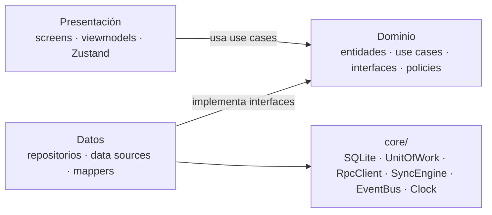
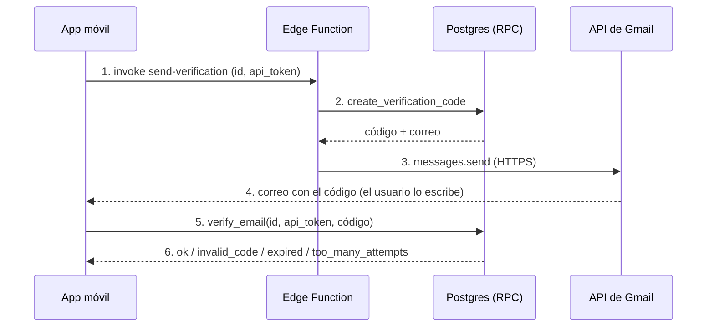
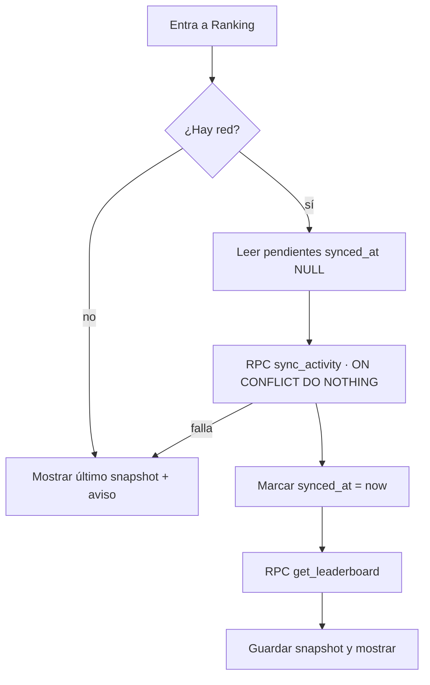

# CONTAITSCCH — Arquitectura por Features

Versión del 31 de octubre de 2026. Fuente editable: documento "CONTAITSCCH — Arquitectura por Features" en Claude.

## Visión general

La app se organiza en **features verticales** (auth, niveles, temas, exámenes, gamificación, ranking…), cada una con su propia **Clean Architecture interna** (domain → data → presentation), sobre un enfoque **offline-first**: SQLite es la fuente de verdad del dispositivo y Supabase solo recibe la actividad para el ranking.

Decisiones clave:

1. **Offline-first real.** Todo el flujo de aprendizaje (niveles, temas, subtemas, exámenes, XP, racha) lee y escribe solo en SQLite. Ninguna pantalla de estudio depende de la red.
2. **Supabase como "tablero público".** Solo guarda `profile`, `xp_event` y `daily_activity`. El contenido del curso nunca sale del dispositivo.
3. **Sincronización por Outbox.** Cada XP y cada día activo se escriben localmente con `synced_at = NULL`. Al entrar a _Ranking_ se suben los pendientes, se marcan y luego se pide el leaderboard.
4. **Datos solo-se-agregan (append-only).** XP y actividad diaria nunca se actualizan ni se borran; las llaves únicas hacen la sincronización idempotente y segura entre varios dispositivos.
5. **Valores derivados, no almacenados.** XP total, racha, nivel desbloqueado y progreso se calculan con consultas o funciones puras, así nunca se desincronizan.
6. **Features desacopladas.** Una feature solo consume la API pública (`index.ts`) de otra, o se comunica por eventos de dominio. Nunca importa sus carpetas internas.

## Stack tecnológico

Propuesta basada en Expo (managed workflow) para acelerar el desarrollo sin perder acceso a módulos nativos.

| Necesidad             | Librería propuesta                                                         | Por qué                                                                                                |
| --------------------- | -------------------------------------------------------------------------- | ------------------------------------------------------------------------------------------------------ |
| Base de la app        | Expo SDK + TypeScript estricto                                             | Builds sencillos, OTA updates, tipado fuerte                                                           |
| Navegación            | Expo Router (o React Navigation 7)                                         | Tabs + stacks + modales, deep links                                                                    |
| Estilos               | **Tailwind CSS v3 vía NativeWind v4**                                      | Clases `className` de Tailwind en componentes RN; los colores del diseño viven en `tailwind.config.js` |
| BD local              | `expo-sqlite` + Drizzle ORM                                                | Consultas tipadas, migraciones versionadas, transacciones                                              |
| API remota            | **SDK `@supabase/supabase-js`** (solo `supabase.rpc()`; sin Supabase Auth) | Un solo cliente; las tablas se acceden únicamente por funciones RPC                                    |
| Hash de contraseña    | `@noble/hashes` (PBKDF2-SHA256) + `expo-crypto` (sal aleatoria)            | JavaScript puro: funciona en Expo Go, sin módulos nativos ni costo                                     |
| Contenido del curso   | JSON en el bundle + Zod                                                    | Temas, subtemas, exámenes y preguntas validados antes de sembrar SQLite                                |
| Estado local de UI    | Zustand                                                                    | Stores pequeños por feature, sin boilerplate                                                           |
| Estado remoto         | TanStack Query                                                             | Caché, reintentos y estado de carga del leaderboard                                                    |
| Formularios           | React Hook Form + Zod                                                      | Validaciones del registro (mínimos, @, requeridos)                                                     |
| Credenciales          | `expo-secure-store`                                                        | Guarda `user_id` + `api_token` cifrados                                                                |
| Conectividad          | `@react-native-community/netinfo`                                          | Saber si se puede sincronizar                                                                          |
| Fechas                | `date-fns` + `date-fns-tz`                                                 | Día local del usuario para la racha                                                                    |
| Gráficos y animación  | `react-native-svg` + Reanimated                                            | Cuentas T, mapa de temas, barras de progreso                                                           |
| Contenido de subtemas | Bloques JSON tipados (ver sección de contenido)                            | Cada bloque se pinta con su componente (texto, Cuenta T, regla, ejemplo)                               |
| Pruebas               | Jest + React Native Testing Library                                        | Unitarias de dominio y de pantallas                                                                    |

## Estructura de carpetas

Cuatro zonas: `app/` son las rutas de Expo Router, `composition/` arma todo (composition root), `core/` y `shared/` son infraestructura y UI reutilizable, y `features/` contiene el negocio. Una feature nunca importa de otra salvo por su `index.ts`.

Expo Router convierte en pantalla cada archivo de `src/app/`, por eso el composition root vive aparte en `src/composition/`.

```text
src/
├── app/                          # Rutas de Expo Router (navegación por archivos)
│   ├── _layout.tsx               # Raíz: fuentes, providers, guard de sesión
│   ├── (auth)/                   # Welcome, Register, VerifyEmail, Login
│   └── (tabs)/                   # Aprender, Niveles, Ranking, Ajustes
│
├── composition/                  # Composition root
│   ├── bootstrap.ts              # Migraciones, seed de contenido, sesión
│   ├── container.ts              # Inyección de dependencias (instancia repos y use cases)
│   └── providers/                # QueryClient, DI (useContainer), SafeArea
│
├── core/                         # Infraestructura sin reglas de negocio
│   ├── database/
│   │   ├── client.ts             # Conexión SQLite, PRAGMA foreign_keys = ON
│   │   ├── schema/               # Tablas Drizzle (una por archivo)
│   │   ├── migrations/           # 0001_init.sql, 0002_…
│   │   ├── seed/                 # content.v1.json + ContentSeeder
│   │   └── UnitOfWork.ts         # Transacciones atómicas
│   ├── network/
│   │   ├── supabaseClient.ts
│   │   ├── RpcClient.ts          # Envoltorio de rpc() con auth (id + api_token)
│   │   └── ConnectivityService.ts
│   ├── sync/
│   │   ├── SyncEngine.ts         # Orquesta push de Outbox
│   │   └── SyncableSource.ts     # Interfaz que implementa cada feature sincronizable
│   ├── session/                  # SessionStore + SecureStorage (user_id, api_token)
│   ├── events/                   # DomainEventBus (Observer)
│   ├── clock/                    # Clock (now(), todayLocal()) inyectable
│   └── result/                   # Result<T, E> y errores de dominio
│
├── shared/                       # UI y utilidades reutilizables
│   ├── ui/                       # Button, Card, ProgressBar, Badge, Avatar, StatPill
│   ├── theme/                    # Colores, tipografía, espaciado (tokens del diseño)
│   └── hooks/                    # useDebounce, useAppState…
│
└── features/
    ├── auth/
    ├── onboarding/               # Introducción a la app
    ├── home/                     # Menú de inicio / dashboard
    ├── levels/                   # Niveles y desbloqueo
    ├── learning/                 # Temario, temas, subtemas
    ├── exams/                    # Examen por nivel
    ├── gamification/             # XP y racha
    ├── leaderboard/              # Ranking online
    └── settings/                 # Ajustes, cerrar sesión
```

Plantilla interna de cada feature (ejemplo con `learning`):

```text
features/learning/
├── domain/
│   ├── entities/          # Topic, Subtopic, TopicStatus
│   ├── repositories/      # TopicRepository.ts (interfaz)
│   ├── policies/          # TopicLockPolicy.ts (reglas puras)
│   └── usecases/          # GetSyllabus, GetTopicSession, CompleteTopic
├── data/
│   ├── datasources/       # TopicLocalDataSource.ts (SQL)
│   ├── mappers/           # TopicRow → Topic
│   └── repositories/      # SqliteTopicRepository.ts (implementación)
├── presentation/
│   ├── screens/           # SyllabusMapScreen, TopicSessionScreen
│   ├── components/        # TopicNode, SubtopicRenderer, StepProgress
│   └── viewmodels/        # useSyllabusViewModel, useTopicSessionViewModel
└── index.ts               # API pública: pantallas, tipos y use cases exportables
```

## Capas y regla de dependencias

Cada feature tiene tres capas y las dependencias solo apuntan hacia `domain`: la UI llama casos de uso y la capa de datos implementa las interfaces que el dominio define (inversión de dependencias).



El dominio no conoce React, SQLite ni Supabase; por eso se prueba con Jest puro y se puede cambiar de motor de BD sin tocar reglas de negocio.

| Capa           | Contiene                                                  | Puede importar                                                               | No puede importar                               |
| -------------- | --------------------------------------------------------- | ---------------------------------------------------------------------------- | ----------------------------------------------- |
| `domain`       | Entidades, use cases, interfaces de repositorio, policies | `core/result`, `core/clock` (interfaz), `index.ts` de otras features         | React, SQLite, Supabase, `data`, `presentation` |
| `data`         | Repositorios concretos, data sources, mappers             | Su `domain`, `core/database`, `core/network`                                 | `presentation`                                  |
| `presentation` | Screens, componentes, viewmodels                          | Sus use cases (vía DI), `shared/ui`, pantallas exportadas por otras features | `data`, SQL o `rpc()` directo                   |

La regla se automatiza con `eslint-plugin-boundaries` (o `import/no-restricted-paths`) para que un import prohibido falle en CI.

Ejemplo de ViewModel (MVVM con hooks): la pantalla solo pinta lo que el hook expone.

```ts
// features/learning/presentation/viewmodels/useTopicSessionViewModel.ts
export function useTopicSessionViewModel(topicId: number) {
  const { getTopicSession, completeTopic } = useLearningUseCases(); // DI
  const [state, setState] = useState<SessionState>({ status: 'loading' });

  useEffect(() => {
    getTopicSession.execute(topicId).then(setState);
  }, [topicId]);

  const next = async () => {
    if (!state.isLastStep) return setState((s) => goToNextStep(s));
    const result = await completeTopic.execute({ topicId });
    if (result.ok) navigation.replace('TopicCompleted', result.value); // +5 XP
  };
  return { state, next, back: () => setState(goToPreviousStep) };
}
```

## Patrones de diseño y SOLID

Se usan diez patrones, cada uno resolviendo un problema concreto del dominio; ninguno se agrega "por si acaso".

| Patrón                                  | Dónde se aplica                                                                                        | Problema que resuelve                                                         |
| --------------------------------------- | ------------------------------------------------------------------------------------------------------ | ----------------------------------------------------------------------------- |
| Repository                              | `TopicRepository`, `XpRepository`, `LeaderboardRepository`…                                            | Ocultar si el dato viene de SQLite o de Supabase                              |
| Use Case / Command                      | `CompleteTopic`, `SubmitExam`, `SyncAndFetchLeaderboard`                                               | Una acción de negocio = una clase con `execute()`                             |
| Dependency Injection + Composition Root | `composition/container.ts`                                                                             | Las capas reciben interfaces; se pueden cambiar por mocks en pruebas          |
| Unit of Work                            | `core/database/UnitOfWork.ts`                                                                          | Completar tema + XP + actividad del día en una sola transacción               |
| Strategy                                | `QuestionGrader` (`MultipleChoiceGrader`, `ComplementaryGrader`), `StreakCalculator`, `XpRewardPolicy` | Cambiar reglas de calificación o de puntos sin tocar el flujo                 |
| Registry / Factory                      | `QuestionTypeRegistry` (grader + componente por `question.type`)                                       | Agregar un tipo de pregunta nuevo sin modificar el examen                     |
| Observer (Event Bus)                    | `TopicCompleted`, `ExamPassed`, `XpAwarded`, `SyncCompleted`                                           | Refrescar Home, header de XP y niveles sin acoplar features                   |
| Outbox                                  | `xp_event.synced_at`, `daily_activity.synced_at`                                                       | Subir lo pendiente cuando haya red, sin perder datos                          |
| Adapter / Mapper                        | `data/mappers/*`                                                                                       | Fila SQLite ↔ entidad ↔ DTO de RPC (snake\_case ↔ camelCase, 0/1 ↔ boolean)   |
| Facade                                  | `SyncEngine`                                                                                           | La pantalla de Ranking llama un solo método; dentro hay push, marcado y fetch |

Cómo se cumple cada principio SOLID:

- **S — Responsabilidad única.** Un use case por acción; los data sources solo ejecutan SQL; los ViewModels solo adaptan estado para la vista; `StreakCalculator` solo calcula la racha.
- **O — Abierto/cerrado.** Un tipo de pregunta nuevo (ej. "ordenar asientos" o "arrastrar a la Cuenta T") se agrega registrando un `QuestionGrader` y un componente en `QuestionTypeRegistry`, sin editar `SubmitExamUseCase`.
- **L — Sustitución de Liskov.** Cualquier `TopicRepository` (SQLite real, en memoria para tests) cumple el mismo contrato y devuelve los mismos tipos `Result`.
- **I — Segregación de interfaces.** Interfaces pequeñas: `XpReader` (total, historial) separado de `XpWriter` (otorgar); `SyncableSource` solo pide `getPending()` y `markSynced()`.
- **D — Inversión de dependencias.** Los use cases dependen de interfaces de `domain`; `composition/container.ts` decide qué implementación concreta se inyecta.

Ejemplo del registro de tipos de pregunta (Open/Closed + Strategy):

```ts
// features/exams/domain/grading/QuestionGrader.ts
export interface QuestionGrader {
  readonly type: QuestionType; // 'multiple_choice' | 'complementary'
  isCorrect(question: Question, answer: Answer): boolean;
}

export class ComplementaryGrader implements QuestionGrader {
  readonly type = 'complementary';
  isCorrect(q: Question, a: Answer) {
    const normalize = (s: string) =>
      s
        .trim()
        .toLowerCase()
        .normalize('NFD')
        .replace(/[\u0300-\u036f]/g, '');
    return q.options.some((o) => o.isCorrect && normalize(o.text) === normalize(a.text));
  }
}

// composition/container.ts
const graders = new QuestionTypeRegistry()
  .register(new MultipleChoiceGrader(), MultipleChoiceQuestionView)
  .register(new ComplementaryGrader(), ComplementaryQuestionView);
```

## Detalle por feature

Nueve features cubren las historias de usuario; solo `auth` y `leaderboard` hablan con Supabase, el resto trabaja 100% en SQLite.

| Feature        | Historia(s)                    | Pantallas                                                                   | Use cases principales                                                                 | Datos                                                                               |
| -------------- | ------------------------------ | --------------------------------------------------------------------------- | ------------------------------------------------------------------------------------- | ----------------------------------------------------------------------------------- |
| `auth`         | Registro, Verificar correo     | Register (paso 1), VerifyEmail (paso 2), Login                              | `RegisterUser`, `VerifyEmailCode`, `ResendCode`, `Login`, `RestoreProgress`, `Logout` | RPC `register`, `verify_email`, `login`, `pull_activity`; tabla `user`; SecureStore |
| `onboarding`   | Introducción a la app          | About (qué es, objetivos, equipo)                                           | `GetAppInfo`                                                                          | JSON estático en el bundle                                                          |
| `home`         | Menú de inicio                 | Home / dashboard (racha, XP, nivel, progreso)                               | Compone use cases de `gamification` y `levels` (no tiene repositorio propio)          | Lee vía APIs públicas                                                               |
| `levels`       | Niveles de contabilidad        | LevelsList (tarjetas con candado y barra)                                   | `GetLevelsOverview`, `IsLevelUnlocked` (`LevelUnlockPolicy`)                          | `level`, `topic`, `topic_progress`, `xp_event`                                      |
| `learning`     | Temario, Desarrollo de un tema | SyllabusMap (camino de temas), TopicSession ("Paso 2 de 4"), TopicCompleted | `GetSyllabus`, `GetTopicSession`, `CompleteTopic`                                     | `topic`, `subtopic`, `topic_progress`                                               |
| `exams`        | Examen de cada módulo          | ExamIntro, ExamSession ("7/10"), ExamResult                                 | `StartExam`, `GradeAnswer`, `SubmitExam`                                              | `exam`, `question`, `question_option`, `exam_attempt`                               |
| `gamification` | Rachas, XP                     | Header (racha, XP), StreakBadge                                             | `AwardXp`, `RecordDailyActivity`, `GetUserStats` (XP total, racha)                    | `xp_event`, `daily_activity`; implementa `SyncableSource`                           |
| `leaderboard`  | Usuarios / Ranking             | Ranking (podio top 3, lista, "Tu posición")                                 | `SyncAndFetchLeaderboard`, `GetMyRank`                                                | RPC `sync_activity`, `get_leaderboard`; caché del último snapshot                   |
| `settings`     | Configuraciones avanzadas      | Settings (perfil, cerrar sesión, forzar sincronización)                     | `UpdateProfile`, `Logout`, `ForceSync`                                                | `user`, SecureStore                                                                 |

Use case central del aprendizaje. Muestra cómo una feature (`learning`) usa la API pública de otra (`gamification`) dentro de una sola transacción:

```ts
// features/learning/domain/usecases/CompleteTopicUseCase.ts
export class CompleteTopicUseCase {
  constructor(
    private readonly uow: UnitOfWork,
    private readonly topics: TopicRepository,
    private readonly awardXp: AwardXpUseCase, // de gamification/index.ts
    private readonly recordActivity: RecordDailyActivityUseCase,
    private readonly session: SessionStore,
    private readonly events: DomainEventBus,
  ) {}

  async execute({ topicId }: { topicId: number }): Promise<Result<TopicCompleted>> {
    const userId = this.session.requireUserId();
    if (await this.topics.isCompleted(userId, topicId)) return ok({ topicId, xp: 0 }); // idempotente

    const xp = await this.uow.run(async (tx) => {
      await this.topics.markCompleted(userId, topicId, tx); // topic_progress
      const points = await this.awardXp.forTopic(userId, topicId, tx); // xp_event (+5, synced_at NULL)
      await this.recordActivity.today(userId, tx); // daily_activity (INSERT OR IGNORE)
      return points;
    });

    this.events.publish({ type: 'TopicCompleted', topicId, xp }); // refresca Home, niveles, header
    return ok({ topicId, xp });
  }
}
```

`SubmitExamUseCase` sigue la misma forma: califica con el `QuestionTypeRegistry`, guarda `exam_attempt` siempre, y solo si `score >= passing_score` y no existía XP de ese examen, inserta el `xp_event` de 100 XP, registra el día y publica `ExamPassed` (que desbloquea el siguiente nivel).

## Autenticación sin Supabase Auth (hash en la app)

La app deriva el hash con PBKDF2-SHA256 y una sal aleatoria por usuario; Supabase solo recibe y compara ese hash mediante funciones RPC llamadas con el SDK, sin usar Supabase Auth. La contraseña en texto plano nunca sale del teléfono ni se guarda en SQLite.

| Paso          | En la app                                                                                             | En Supabase (RPC vía `supabase.rpc`)                                                                                     |
| ------------- | ----------------------------------------------------------------------------------------------------- | ------------------------------------------------------------------------------------------------------------------------ |
| Registro      | Genera sal de 16 bytes (`expo-crypto`), calcula `PBKDF2(password, sal, 60 000 iteraciones, 32 bytes)` | `register(email, nombres, país, estado, ciudad, hash, sal, iteraciones)` guarda el perfil y devuelve `id` + `api_token`  |
| Enviar código | Llama `supabase.functions.invoke('send-verification')`                                                | Edge Function genera código de 6 dígitos, guarda su hash con vencimiento de 10 min y envía el correo con la API de Gmail |
| Verificar     | Envía el código escrito                                                                               | `verify_email(id, token, code)` marca `email_verified = true`; máximo 5 intentos, reenvío cada 45 s                      |
| Login         | Pide la sal, recalcula el hash con la contraseña escrita                                              | `get_login_params(email)` devuelve sal + iteraciones; `login(email, hash)` compara y devuelve `id`, `api_token` y perfil |
| Sesión        | Guarda `id` + `api_token` en SecureStore; ya no pide login, ni siquiera offline                       | Cada RPC posterior valida `id` + `api_token`                                                                             |

Tres protecciones que no cuestan nada y conviene incluir:

- **Doble hash en el servidor.** El hash de la app funciona como "la contraseña" ante el servidor. Si se guardara tal cual, quien lea la tabla podría iniciar sesión con él. Por eso Postgres guarda `digest(hash_cliente, 'sha256')` (extensión `pgcrypto`, incluida en Supabase) y compara contra eso.
- **Sin enumeración de correos.** Si el correo no existe, `get_login_params` devuelve una sal falsa pero estable (derivada del correo), y `login` responde el mismo error genérico.
- **Iteraciones guardadas por usuario.** Si más adelante se sube de 60 000 a otro valor, los usuarios antiguos siguen entrando con las suyas.

Puerto de dominio + implementación (Strategy, se puede cambiar de algoritmo sin tocar los use cases):

```ts
// features/auth/domain/ports/PasswordHasher.ts
export interface PasswordHasher {
  createSalt(): Promise<string>;
  hash(password: string, salt: string, iterations: number): Promise<string>;
}

// features/auth/data/crypto/Pbkdf2PasswordHasher.ts
import { pbkdf2Async } from '@noble/hashes/pbkdf2';
import { sha256 } from '@noble/hashes/sha256';
import { bytesToHex, hexToBytes } from '@noble/hashes/utils';
import * as Crypto from 'expo-crypto';

export class Pbkdf2PasswordHasher implements PasswordHasher {
  async createSalt() {
    return bytesToHex(await Crypto.getRandomBytesAsync(16));
  }
  async hash(password: string, salt: string, iterations: number) {
    const key = await pbkdf2Async(sha256, password.normalize('NFKC'), hexToBytes(salt),
                                  { c: iterations, dkLen: 32 }); // async: no congela la UI
    return bytesToHex(key);
  }
}

// features/auth/domain/usecases/LoginUseCase.ts
async execute({ email, password }: LoginInput): Promise<Result<Session>> {
  const params = await this.remote.getLoginParams(email.trim().toLowerCase());
  const hash = await this.hasher.hash(password, params.salt, params.iterations);
  const session = await this.remote.login(email, hash);   // supabase.rpc('login', …)
  if (!session.ok) return err('INVALID_CREDENTIALS');
  await this.sessionStore.save(session.value);            // SecureStore
  await this.restoreProgress.execute(session.value);      // baja xp_event / daily_activity
  return session;
}
```

Cambios al modelo de Postgres:

```sql
create extension if not exists pgcrypto;

alter table profile
  add column password_salt       text    not null,
  add column password_iterations integer not null default 60000,
  add column email_verified      boolean not null default false,
  add column timezone            text    not null default 'America/Mexico_City';
-- password_hash ahora guarda digest(hash_de_la_app, 'sha256') en hex

create table email_verification (
  profile_id  uuid primary key references profile(id) on delete cascade,
  code_hash   text        not null,          -- sha256 del código de 6 dígitos
  expires_at  timestamptz not null,
  attempts    integer     not null default 0,
  last_sent_at timestamptz not null default now()
);

-- dentro de login(): comparación contra el doble hash
select id, api_token into v_id, v_token
from profile
where email = lower(p_email)
  and password_hash = encode(digest(p_hash, 'sha256'), 'hex');
```

Nota de rendimiento: 60 000 iteraciones en JavaScript puro tardan alrededor de un segundo en un teléfono de gama media; se muestra un indicador de carga en el botón. Si resulta lento en los equipos de prueba, se baja el valor (queda guardado por usuario).

### Envío con Gmail y código de verificación

Postgres genera el código, una Edge Function lo envía con la **API de Gmail** y Postgres lo valida. La app nunca recibe el código: solo lo conoce quien abre el correo.

> **Versión real:** el SQL de esta sección es el diseño original. La implementación vigente está en `supabase/migrations/` y sus pruebas en `supabase/tests/`. Diferencias: todas las RPC responden con un `status` en vez de lanzar excepciones (`create_verification_code` devuelve `cooldown` con `retry_in_seconds`, `invalid_token` o `already_verified`), validan `id + api_token` con `private.is_owner`, y `verify_email` responde `ok` si el correo ya estaba verificado.



Se usa la API de Gmail (HTTPS) en lugar de SMTP porque las Edge Functions de Supabase no permiten conexiones salientes por los puertos 25 y 587 ([Brevo · integración con Supabase](https://www.brevo.com/es/integrations/supabase/)). Una cuenta de Gmail gratuita alcanza para un proyecto escolar (Google limita el envío diario, del orden de cientos de correos).

**Configurar Google (una sola vez, con la cuenta Gmail del proyecto):**

1. En Google Cloud Console, crear un proyecto y habilitar **Gmail API**.
2. En _Pantalla de consentimiento de OAuth_: tipo Externo, agregar el permiso `https://www.googleapis.com/auth/gmail.send` y cambiar el estado a **En producción**. En modo "Prueba" el refresh token caduca a los 7 días y los correos dejarían de salir. Google mostrará "app no verificada"; se acepta porque solo tú la autorizas.
3. En _Credenciales_: crear un ID de cliente OAuth de tipo "Aplicación web" con URI de redirección `https://developers.google.com/oauthplayground`.
4. En OAuth 2.0 Playground: engrane → _Use your own OAuth credentials_, autorizar el permiso `gmail.send` con la cuenta del proyecto e intercambiar el código por un **refresh token**.
5. Guardar los secretos en Supabase (nunca en la app ni en el repositorio):

```bash
npx supabase secrets set GMAIL_CLIENT_ID=... GMAIL_CLIENT_SECRET=... \
  GMAIL_REFRESH_TOKEN=... GMAIL_SENDER=contaitscch.app@gmail.com
```

**Generar el código (Postgres).** Solo la Edge Function puede ejecutar esta función, porque es la única que devuelve el código en claro. En la tabla se guarda su hash, con vencimiento de 10 minutos y espera de 45 s entre reenvíos (el contador "Reenviar en 00:45" del diseño):

```sql
create or replace function create_verification_code(p_user_id uuid, p_token uuid)
returns jsonb
language plpgsql security definer
set search_path = public, extensions as $$
declare
  v_email text;
  v_last  timestamptz;
  v_code  text;
begin
  select email into v_email from profile
  where id = p_user_id and api_token = p_token and not email_verified;
  if v_email is null then raise exception 'invalid_or_already_verified'; end if;

  select last_sent_at into v_last from email_verification where profile_id = p_user_id;
  if v_last > now() - interval '45 seconds' then raise exception 'cooldown'; end if;

  -- 6 dígitos con generador criptográfico (no random())
  v_code := lpad(((('x' || encode(gen_random_bytes(3), 'hex'))::bit(24)::int) % 1000000)::text, 6, '0');

  insert into email_verification (profile_id, code_hash, expires_at, attempts, last_sent_at)
  values (p_user_id, encode(digest(v_code, 'sha256'), 'hex'), now() + interval '10 minutes', 0, now())
  on conflict (profile_id) do update
    set code_hash = excluded.code_hash, expires_at = excluded.expires_at,
        attempts = 0, last_sent_at = now();

  return jsonb_build_object('email', v_email, 'code', v_code);
end $$;

revoke execute on function create_verification_code(uuid, uuid) from public, anon, authenticated;
grant  execute on function create_verification_code(uuid, uuid) to service_role;
```

**Enviar el correo (Edge Function `send-verification`, Deno):**

```ts
// supabase/functions/send-verification/index.ts
import { createClient } from 'npm:@supabase/supabase-js@2';

const env = (k: string) => Deno.env.get(k)!;
const admin = createClient(env('SUPABASE_URL'), env('SUPABASE_SERVICE_ROLE_KEY'));

Deno.serve(async (req) => {
  const { userId, apiToken } = await req.json();
  const { data, error } = await admin.rpc('create_verification_code', {
    p_user_id: userId,
    p_token: apiToken,
  });
  if (error) return Response.json({ error: error.message }, { status: 400 }); // cooldown, invalid…

  await sendGmail(data.email, data.code);
  return Response.json({ ok: true, resendInSeconds: 45 });
});

async function getAccessToken(): Promise<string> {
  const res = await fetch('https://oauth2.googleapis.com/token', {
    method: 'POST',
    headers: { 'Content-Type': 'application/x-www-form-urlencoded' },
    body: new URLSearchParams({
      client_id: env('GMAIL_CLIENT_ID'),
      client_secret: env('GMAIL_CLIENT_SECRET'),
      refresh_token: env('GMAIL_REFRESH_TOKEN'),
      grant_type: 'refresh_token',
    }),
  });
  return (await res.json()).access_token;
}

const b64 = (s: string) => btoa(String.fromCharCode(...new TextEncoder().encode(s)));
const b64url = (s: string) => b64(s).replace(/\+/g, '-').replace(/\//g, '_').replace(/=+$/, '');

async function sendGmail(to: string, code: string) {
  const mime = [
    `From: CONTAITSCCH <${env('GMAIL_SENDER')}>`,
    `To: ${to}`,
    `Subject: =?UTF-8?B?${b64('Tu código de verificación')}?=`, // asunto con acentos
    'MIME-Version: 1.0',
    'Content-Type: text/html; charset=UTF-8',
    '',
    `<p>Tu código para entrar a CONTAITSCCH es:</p>
     <h1 style="letter-spacing:8px">${code}</h1>
     <p>Vence en 10 minutos. Si no fuiste tú, ignora este correo.</p>`,
  ].join('\r\n');

  const res = await fetch('https://gmail.googleapis.com/gmail/v1/users/me/messages/send', {
    method: 'POST',
    headers: {
      Authorization: `Bearer ${await getAccessToken()}`,
      'Content-Type': 'application/json',
    },
    body: JSON.stringify({ raw: b64url(mime) }),
  });
  if (!res.ok) throw new Error(`gmail_send_failed ${res.status}`);
}
```

**Validar el código (Postgres).** Compara hashes, cuenta intentos (máximo 5) y revisa el vencimiento; si es correcto, marca el correo como verificado y borra el código para que no se pueda reusar:

```sql
create or replace function verify_email(p_user_id uuid, p_token uuid, p_code text)
returns text
language plpgsql security definer
set search_path = public, extensions as $$
declare
  v email_verification%rowtype;
begin
  perform 1 from profile where id = p_user_id and api_token = p_token;
  if not found then return 'invalid_token'; end if;

  select * into v from email_verification where profile_id = p_user_id for update;
  if not found              then return 'no_code'; end if;
  if v.expires_at < now()   then return 'expired'; end if;
  if v.attempts >= 5        then return 'too_many_attempts'; end if;

  if v.code_hash <> encode(digest(trim(p_code), 'sha256'), 'hex') then
    update email_verification set attempts = attempts + 1 where profile_id = p_user_id;
    return 'invalid_code';
  end if;

  update profile set email_verified = true where id = p_user_id;
  delete from email_verification where profile_id = p_user_id;
  return 'ok';
end $$;

grant execute on function verify_email(uuid, uuid, text) to anon;
```

**En la app (feature `auth`):**

```ts
// features/auth/domain/usecases/RequestVerificationCodeUseCase.ts
async execute(): Promise<Result<{ resendInSeconds: number }>> {
  const { userId, apiToken } = this.session.require();
  const { data, error } = await supabase.functions.invoke('send-verification',
    { body: { userId, apiToken } });
  return error ? err('SEND_FAILED') : ok(data);
}

// features/auth/domain/usecases/VerifyEmailCodeUseCase.ts
async execute(code: string): Promise<Result<void>> {
  if (!/^\d{6}$/.test(code)) return err('invalid_code');            // validación local rápida
  const { userId, apiToken } = this.session.require();
  const { data, error } = await supabase.rpc('verify_email',
    { p_user_id: userId, p_token: apiToken, p_code: code });
  if (error) return err('NETWORK');
  if (data !== 'ok') return err(data);                               // ver tabla de mensajes
  await this.users.markEmailVerified(userId);                        // SQLite: email_verified = 1
  this.session.setVerified();                                        // el guard abre AppStack sin login
  return ok(undefined);
}
```

| Respuesta                 | Mensaje en pantalla                           | Acción                                       |
| ------------------------- | --------------------------------------------- | -------------------------------------------- |
| `ok`                      | —                                             | Entra al curso sin volver a iniciar sesión   |
| `invalid_code`            | "Código incorrecto, revisa tu correo"         | Limpiar las 6 casillas                       |
| `expired`                 | "El código venció, te enviamos uno nuevo"     | Llamar `RequestVerificationCode`             |
| `too_many_attempts`       | "Demasiados intentos, solicita otro código"   | Habilitar "Reenviar" al terminar el contador |
| `cooldown` (al reenviar)  | "Espera unos segundos para reenviar"          | Mantener el contador de 45 s                 |
| `NETWORK` / `SEND_FAILED` | "Necesitas conexión para verificar tu correo" | Botón de reintentar                          |

## Contenido del curso en JSON

Temas, subtemas, exámenes y preguntas se escriben en archivos JSON dentro de la app; en el primer arranque (o al cambiar de versión) un `ContentSeeder` los valida con Zod y los copia a SQLite en una sola transacción. Las pantallas siempre leen de SQLite, nunca del JSON directamente.

Un archivo por nivel, para que los profesores editen sin pisarse:

```text
src/core/database/seed/
├── content/
│   ├── manifest.json          # { "version": 1, "levels": ["basico.json", …] }
│   ├── basico.json
│   ├── intermedio.json
│   └── avanzado.json
├── contentSchema.ts           # Esquemas Zod (fuente de los tipos TS)
└── ContentSeeder.ts
```

Estructura de un nivel. El contenido de cada subtema es una lista de **bloques tipados**, así se pueden pintar las tarjetas DEBE/HABER, la regla de oro o un ejemplo como en las capturas, y no solo texto:

```json
{
  "level": {
    "id": 1,
    "name": "Básico",
    "sortOrder": 1,
    "title": "Introducción a la Contabilidad",
    "tagline": "Domina los cimientos financieros paso a paso.",
    "subtitle": "Fundamentos y Cuentas",
    "description": "Domina la estructura del Activo, Pasivo y Capital…"
  },
  "topics": [
    {
      "id": 104,
      "title": "Cuentas T (Esquemas de Mayor)",
      "sortOrder": 4,
      "subtopics": [
        {
          "id": 10402,
          "title": "¿Qué es una Cuenta T y cómo funciona?",
          "sortOrder": 2,
          "blocks": [
            {
              "type": "paragraph",
              "text": "El esquema de mayor o **Cuenta T** es la herramienta gráfica…"
            },
            {
              "type": "t_account",
              "debit": {
                "label": "Lado izquierdo • Cargos",
                "items": ["+ Activo", "+ Gasto", "− Pasivo"]
              },
              "credit": {
                "label": "Lado derecho • Abonos",
                "items": ["+ Pasivo", "+ Capital / Ingreso", "− Activo"]
              }
            },
            {
              "type": "callout",
              "icon": "scale",
              "title": "Regla de Oro de la Partida Doble",
              "text": "A todo cargo corresponde un abono equivalente."
            }
          ]
        }
      ]
    }
  ],
  "exam": {
    "id": 1,
    "xpReward": 100,
    "passingScore": 70,
    "questions": [
      {
        "id": 1001,
        "type": "multiple_choice",
        "sortOrder": 1,
        "statement": "La empresa adquiere mobiliario de oficina por $15,000 MXN en efectivo. ¿Cómo se registra?",
        "options": [
          { "id": 100101, "text": "Cargar a Mobiliario, abonar a Bancos", "isCorrect": true },
          {
            "id": 100102,
            "text": "Abonar a Mobiliario, cargar a Capital Social",
            "isCorrect": false
          }
        ],
        "feedback": "El mobiliario aumenta el Activo por el DEBE y el efectivo lo disminuye por el HABER."
      },
      {
        "id": 1002,
        "type": "complementary",
        "sortOrder": 2,
        "statement": "El lado izquierdo de una Cuenta T se llama ____.",
        "options": [{ "id": 100201, "text": "Debe", "isCorrect": true }]
      }
    ]
  }
}
```

Reglas del contenido:

- **Ids fijos e inmutables.** Supabase guarda `topic_id` y `exam_id` en `xp_event`; si un id cambia, el XP queda apuntando a otro tema. Convención sugerida: tema = nivel×100 + orden, subtema = tema×100 + orden.
- **Siembra por versión.** El seeder compara `manifest.version` con `content_meta.version` en SQLite; si es mayor, hace `INSERT … ON CONFLICT(id) DO UPDATE` del contenido. El progreso del usuario no se toca.
- **Bloques extensibles.** Cada `type` de bloque tiene un componente registrado (`paragraph`, `t_account`, `callout`, `example`, `image`). Un bloque nuevo = esquema Zod + componente, mismo patrón Registry que las preguntas.
- **La columna `subtopic.content`** guarda el arreglo `blocks` serializado (`JSON.stringify`), y `question.feedback` se agrega como columna opcional para el mensaje de "¡Excelente!".
- **Validación en CI.** Un test carga todos los JSON con los esquemas Zod; un error de captura falla el build antes de llegar al teléfono.

```ts
// core/database/seed/ContentSeeder.ts
export class ContentSeeder {
  async seedIfNeeded(): Promise<void> {
    const manifest = ManifestSchema.parse(require('./content/manifest.json'));
    if ((await this.meta.getContentVersion()) >= manifest.version) return;

    const levels = LEVEL_FILES.map((file) => LevelContentSchema.parse(file)); // falla si el JSON está mal
    await this.uow.run(async (tx) => {
      for (const l of levels) await this.writer.upsertLevel(l, tx); // level, topic, subtopic, exam, question, option
      await this.meta.setContentVersion(manifest.version, tx);
    });
  }
}
```

Las respuestas correctas viajan dentro del bundle, así que un usuario técnico podría leerlas; para un proyecto escolar es aceptable y es el precio de funcionar sin internet.

## Estilos con Tailwind (NativeWind)

Tailwind se usa a través de NativeWind v4, que convierte las clases `className` en estilos nativos; los colores de las capturas se definen una sola vez como tokens en `tailwind.config.js` y ninguna pantalla escribe un color a mano.

```js
// tailwind.config.js (colores aproximados tomados de las capturas)
module.exports = {
  content: ['./src/**/*.{ts,tsx}'],
  presets: [require('nativewind/preset')],
  theme: {
    extend: {
      colors: {
        bg: '#0A1628', // fondo azul noche
        card: '#14213A', // tarjetas
        primary: '#00E676', // verde de botones y progreso
        accent: '#4DD0E1', // cian de "HABER" y tema activo
        streak: '#FBBF24', // fuego de racha y oro del podio
        muted: '#8A9BB5', // textos secundarios
      },
      fontFamily: { display: ['PlusJakartaSans_700Bold'] },
    },
  },
};
```

Reglas para que escale:

- **Clases solo en `shared/ui`.** Las features usan `<Button variant="primary">`, `<Card>`, `<ProgressBar>`; las combinaciones de clases viven en esos componentes con `tailwind-variants`, no repetidas en cada pantalla.
- **Estados por variantes:** `locked`, `inProgress`, `completed` para tarjetas de nivel y nodos del mapa, en lugar de condicionales de estilo en la pantalla.
- **Lo que Tailwind no cubre** (la curva del mapa de temas, la Cuenta T animada) se dibuja con `react-native-svg` leyendo los mismos tokens desde `theme/colors.ts`.

```tsx
// shared/ui/Button.tsx
const button = tv({
  base: 'h-14 flex-row items-center justify-center gap-2 rounded-2xl',
  variants: {
    variant: {
      primary: 'bg-primary',
      ghost: 'bg-card',
      locked: 'bg-card opacity-50',
    },
  },
});

export function Button({ variant = 'primary', label, ...props }: ButtonProps) {
  return (
    <Pressable className={button({ variant })} {...props}>
      <Text className="font-display text-lg text-bg">{label}</Text>
    </Pressable>
  );
}
```

## Sincronización SQLite ↔ Supabase

La sincronización es de un solo sentido en el uso diario (dispositivo → Supabase) y ocurre al entrar a Ranking: primero se suben los pendientes y solo después se pide el leaderboard, así el usuario siempre se ve con su XP actualizado.



Si la subida falla, nada se marca como sincronizado y los pendientes se reintentan la próxima vez; como el servidor ignora duplicados, reintentar nunca suma XP de más.

Por qué es seguro (idempotente y multi-dispositivo):

- **Outbox local:** `synced_at IS NULL` es la cola. No hace falta una tabla extra de cola.
- **Llaves naturales:** `xp_event (user_id, topic_id)`, `(user_id, exam_id)` y `daily_activity (user_id, activity_date)` son únicas en ambos lados; el servidor usa `INSERT … ON CONFLICT DO NOTHING`.
- **El id local no viaja:** el `id` autonumérico de SQLite no se envía; el servidor genera el suyo. Lo que identifica al evento es la llave natural.
- **Marcado atómico:** `markSynced(ids)` corre en una transacción después de la respuesta exitosa.
- **Exclusión mutua:** el `SyncEngine` usa un candado en memoria para que dos entradas rápidas a Ranking no suban lo mismo en paralelo.

Restauración en un dispositivo nuevo (único momento en que se baja información): al iniciar sesión, `RestoreProgress` llama `pull_activity`, inserta los `xp_event` y `daily_activity` del servidor con `synced_at` ya puesto, y reconstruye `topic_progress` desde los eventos con `topic_id`.

Contrato del `SyncEngine` (Facade + interfaz segregada):

```ts
// core/sync/SyncableSource.ts
export interface SyncableSource<T> {
  readonly name: string;                       // 'xp_event' | 'daily_activity'
  getPending(userId: string): Promise<T[]>;
  markSynced(keys: T[], at: string, tx: Tx): Promise<void>;
}

// features/leaderboard/domain/usecases/SyncAndFetchLeaderboardUseCase.ts
async execute(): Promise<Result<LeaderboardView>> {
  if (await this.connectivity.isOnline()) {
    const pushed = await this.syncEngine.pushPending();      // no lanza: devuelve Result
    if (!pushed.ok) return this.fromCache('sync_failed');
    const fresh = await this.remote.getLeaderboard({ limit: 50 });
    if (fresh.ok) { await this.cache.save(fresh.value); return ok(fresh.value); }
  }
  return this.fromCache('offline');
}
```

Firma sugerida de la RPC en Postgres:

```sql
create function sync_activity(p_user_id uuid, p_token uuid,
                              p_xp jsonb, p_days jsonb)
returns jsonb  -- { xp_inserted, days_inserted }
language plpgsql security definer as $$
begin
  perform assert_owner(p_user_id, p_token);   -- valida api_token
  insert into xp_event (user_id, topic_id, exam_id, points, earned_at)
  select p_user_id, (e->>'topic_id')::int, (e->>'exam_id')::int,
         (e->>'points')::int, (e->>'earned_at')::timestamptz
  from jsonb_array_elements(p_xp) e
  on conflict do nothing;
  insert into daily_activity (user_id, activity_date)
  select p_user_id, (d #>> '{}')::date from jsonb_array_elements(p_days) d
  on conflict do nothing;
  return jsonb_build_object('ok', true);
end $$;
```

## Reglas de negocio

Todas las reglas viven en `domain` como funciones o policies puras, se calculan desde SQLite y nunca se guardan como columnas.

| Regla                       | Definición                                                                                                                | Dónde vive                             |
| --------------------------- | ------------------------------------------------------------------------------------------------------------------------- | -------------------------------------- |
| XP por tema                 | +5 XP la primera vez que se completa (índice único `user_id, topic_id`)                                                   | `gamification/domain/XpRewardPolicy`   |
| XP por examen               | +100 XP la primera vez que se aprueba (`score >= passing_score`); reintentos no suman                                     | `XpRewardPolicy` + `SubmitExamUseCase` |
| XP total                    | `SUM(points)` de `xp_event` del usuario                                                                                   | `XpRepository.getTotal()`              |
| Racha                       | Días consecutivos en `daily_activity` que terminan hoy o ayer; si el último día activo es anteayer o antes, la racha es 0 | `gamification/domain/StreakCalculator` |
| Tema bloqueado              | Bloqueado si el tema con `sort_order - 1` del mismo nivel no está en `topic_progress`                                     | `learning/domain/TopicLockPolicy`      |
| Examen disponible           | Todos los temas del nivel completados                                                                                     | `levels/domain/LevelUnlockPolicy`      |
| Nivel desbloqueado          | Nivel 1 siempre; los demás si existe `xp_event` del examen del nivel anterior                                             | `LevelUnlockPolicy`                    |
| Progreso del nivel          | Temas completados / total de temas del nivel (100% si aprobó el examen)                                                   | `GetLevelsOverview`                    |
| Nivel del usuario (ranking) | El nivel más alto desbloqueado                                                                                            | Vista `leaderboard` en Postgres        |

Cálculo de racha como función pura (fácil de probar con un `Clock` falso):

```ts
// features/gamification/domain/StreakCalculator.ts
export function calculateStreak(activeDays: string[], today: string): number {
  // activeDays: 'YYYY-MM-DD' (día local), today: día local actual
  const days = new Set(activeDays);
  const yesterday = addDays(today, -1);
  let cursor = days.has(today) ? today : days.has(yesterday) ? yesterday : null;
  let streak = 0;
  while (cursor && days.has(cursor)) {
    streak++;
    cursor = addDays(cursor, -1);
  }
  return streak;
}
```

Consultas base en SQLite:

```sql
-- Nivel desbloqueado: el nivel N se abre si se aprobó el examen del nivel N-1
SELECT l.id, l.name,
       CASE WHEN l.sort_order = 1 OR EXISTS (
         SELECT 1 FROM xp_event x
         JOIN exam e ON e.id = x.exam_id
         JOIN level prev ON prev.id = e.level_id
         WHERE x.user_id = :userId AND prev.sort_order = l.sort_order - 1
       ) THEN 1 ELSE 0 END AS unlocked,
       (SELECT COUNT(*) FROM topic_progress tp JOIN topic t ON t.id = tp.topic_id
         WHERE tp.user_id = :userId AND t.level_id = l.id) AS completed_topics,
       (SELECT COUNT(*) FROM topic t WHERE t.level_id = l.id) AS total_topics
FROM level l
ORDER BY l.sort_order;
```

El día de `daily_activity` se calcula siempre con el `Clock` inyectado y la zona horaria del dispositivo, nunca con `CURRENT_TIMESTAMP` (que es UTC): en México, una lección a las 19:00 ya sería "mañana" en UTC y rompería la racha.

## Navegación

Un `RootNavigator` decide entre dos mundos según la sesión guardada: el flujo de registro o las 4 pestañas de las capturas (Aprender, Niveles, Ranking, Ajustes). Las sesiones de tema y examen se abren como pantallas completas fuera de las pestañas.

```text
RootNavigator (guard: ¿hay user_id + api_token + email_verified = 1?)
├── AuthStack                      (features/auth, features/onboarding)
│   ├── Welcome / About
│   ├── Register        → paso 1 "Tus datos"
│   ├── VerifyEmail     → paso 2 "Verificación" (OTP 6 dígitos, reenviar 00:45)
│   └── Login
└── AppStack
    ├── MainTabs
    │   ├── Aprender   → SyllabusMap del nivel actual  (learning)
    │   ├── Niveles    → Home/LevelsList + "Conoce CONTAITSCCH"  (home, levels)
    │   ├── Ranking    → Leaderboard (dispara la sincronización)  (leaderboard)
    │   └── Ajustes    → Settings  (settings)
    ├── TopicSession      (fullScreen)  → TopicCompleted
    ├── ExamSession       (fullScreen)  → ExamResult
    └── About             (modal)       (onboarding)
```

Cada feature exporta sus pantallas desde su `index.ts`, y solo las rutas de `src/app/` (Expo Router) las ensamblan; así agregar una feature nueva no obliga a tocar las existentes. Tras verificar el correo, `VerifyEmailCode` guarda la sesión y el guard cambia a `AppStack` sin pedir login otra vez, como pide la historia.

## Observaciones sobre los modelos de datos

Los modelos están bien orientados (append-only, valores derivados, ids compartidos). La autenticación ya quedó decidida (hash en la app, sin Supabase Auth); falta confirmar qué significan los "+20 XP" y las vidas del diseño.

| #   | Hallazgo                                                                                                                                          | Riesgo                                                                                  | Recomendación                                                                                                                                                                                                  |
| --- | ------------------------------------------------------------------------------------------------------------------------------------------------- | --------------------------------------------------------------------------------------- | -------------------------------------------------------------------------------------------------------------------------------------------------------------------------------------------------------------- |
| 1   | El modelo SQLite menciona Supabase Auth y el de Postgres no                                                                                       | Dos diseños de autenticación incompatibles                                              | **Resuelto:** sin Supabase Auth, hash PBKDF2 en la app y doble hash en Postgres (ver sección de autenticación). Corregir la nota de la tabla `user` en el DBML de SQLite                                       |
| 2   | La historia pide código de verificación por correo y `profile` no tenía dónde guardarlo                                                           | Sin Supabase Auth no hay envío de correos                                               | **Resuelto:** `profile.email_verified`, tabla `email_verification` y Edge Function `send-verification` invocada con el SDK                                                                                     |
| 3   | Las capturas muestran "+20 XP" por pregunta y vidas (corazones), pero la regla es 5 por tema / 100 por examen y Postgres tiene `CHECK` de 5 o 100 | El XP de la UI no coincide con el del ranking                                           | Confirmar con el cliente: o se quitan los "+20 XP" del diseño, o se agrega un tipo de evento (`source`: topic, exam, question) y se ajusta el `CHECK`. Las vidas infinitas se tratan solo como elemento visual |
| 4   | El registro necesita internet (el id lo genera el servidor)                                                                                       | El usuario no puede empezar sin red                                                     | Dejarlo explícito en la UI ("Necesitas conexión para registrarte"); después todo funciona offline                                                                                                              |
| 5   | No se guarda en qué subtema se quedó el usuario (el mapa muestra "2/3")                                                                           | Al cerrar la app, el tema reinicia en el paso 1                                         | Tabla local `subtopic_progress (user_id, subtopic_id, viewed_at)` o una fila en `app_state` con el último paso                                                                                                 |
| 6   | `topic_progress` no existe en Supabase                                                                                                            | En un dispositivo nuevo no se ven los temas completados                                 | Al iniciar sesión, `RestoreProgress` reconstruye `topic_progress` desde los `xp_event` con `topic_id` (ya marcados como sincronizados)                                                                         |
| 7   | Los ids del contenido viven en Supabase sin llave foránea                                                                                         | Si una versión nueva del JSON renumera temas, el XP apunta a otro tema                  | Ids de contenido **inmutables** en los JSON; tabla `content_meta (version)` y siembra por versión                                                                                                              |
| 8   | La racha del leaderboard se calcula con la fecha del servidor (UTC)                                                                               | En México, después de las 18:00 el servidor ya está en "mañana" y puede mostrar racha 0 | Usar `profile.timezone` y calcular "hoy" con `now() AT TIME ZONE profile.timezone`                                                                                                                             |
| 9   | El XP es autoridad del cliente                                                                                                                    | Alguien podría inflar su XP                                                             | Para un proyecto escolar es aceptable; mínimo validar en la RPC que `topic_id`/`exam_id` existan en un catálogo de ids permitidos y limitar eventos por día                                                    |
| 10  | Sin caché del ranking                                                                                                                             | Sin red, la pantalla de Ranking queda vacía                                             | Guardar el último snapshot (`leaderboard_cache` con JSON y `fetched_at`) y mostrar "Actualizado hace X"                                                                                                        |

Ajustes sugeridos al esquema SQLite:

```sql
-- xp_event: exactamente uno de topic_id / exam_id, puntos positivos
CHECK ((topic_id IS NULL) <> (exam_id IS NULL)),
CHECK (points > 0)

-- Índices parciales para encontrar rápido lo pendiente de sincronizar
CREATE INDEX idx_xp_event_pending ON xp_event(user_id) WHERE synced_at IS NULL;
CREATE INDEX idx_daily_activity_pending ON daily_activity(user_id) WHERE synced_at IS NULL;

-- updated_at automático (repetir por tabla editable)
CREATE TRIGGER trg_user_updated_at AFTER UPDATE ON user
BEGIN
  UPDATE user SET updated_at = strftime('%Y-%m-%dT%H:%M:%fZ','now') WHERE id = NEW.id;
END;
```

Nota: en SQLite, `user` no es palabra reservada estricta pero conviene citarla (`"user"`) en el SQL crudo para evitar sorpresas; con Drizzle se maneja solo.

## Pruebas, escalabilidad y hoja de ruta

La mayor parte de la lógica es pura (policies, use cases con repos falsos), así que la pirámide de pruebas se apoya en unitarias rápidas.

| Nivel de prueba      | Qué se prueba                                                                                       | Herramienta                  |
| -------------------- | --------------------------------------------------------------------------------------------------- | ---------------------------- |
| Unitarias de dominio | `StreakCalculator`, `TopicLockPolicy`, `LevelUnlockPolicy`, graders, use cases con repos en memoria | Jest                         |
| Integración de datos | Repositorios SQLite contra una BD real en memoria; idempotencia del Outbox                          | Jest + `better-sqlite3`      |
| Contrato remoto      | RPC `sync_activity` con eventos duplicados no duplica XP                                            | Supabase local (CLI) + pgTAP |
| UI                   | Pantallas con ViewModels mockeados (candados, barras, "7/10")                                       | React Native Testing Library |
| E2E                  | Registro → tema → examen → ranking, con y sin red                                                   | Maestro                      |

Cómo escala la arquitectura:

- **Nuevos tipos de pregunta** (arrastrar a la Cuenta T, ordenar asientos): un grader + un componente registrados; el examen no cambia.
- **Nuevos módulos o temas:** se agregan al JSON de contenido con ids nuevos y una migración de contenido versionada.
- **Nuevas features** (logros, ligas semanales, notificaciones de racha): carpeta nueva en `features/`, se suscriben a eventos existentes (`TopicCompleted`, `ExamPassed`) sin tocar a quien los emite.
- **Nuevos datos sincronizables:** implementan `SyncableSource` y se registran en el `SyncEngine`.
- **Contenido remoto a futuro:** el `ContentSeeder` puede cambiar de "JSON en el bundle" a "descarga desde Supabase Storage" sin afectar a `learning` ni `exams`, porque leen del repositorio.

Hoja de ruta sugerida:

1. **Fundación:** Expo + TypeScript, `core/database` con migraciones y seed, DI, theme y componentes base de `shared/ui`.
2. **Auth:** RPC de registro/login en Postgres, `PasswordHasher` PBKDF2, Edge Function de código por correo, login, sesión segura, `RestoreProgress`.
3. **Aprendizaje offline:** `levels` + `learning` (mapa de temas, sesión por pasos, completar tema) + `gamification` (XP y racha).
4. **Exámenes:** registro de tipos de pregunta, sesión "7/10", resultado y desbloqueo de nivel.
5. **Ranking:** RPC en Supabase, `SyncEngine`, podio, "Tu posición", caché offline.
6. **Pulido:** onboarding/About, ajustes, animaciones, pruebas E2E y publicación en tiendas.
