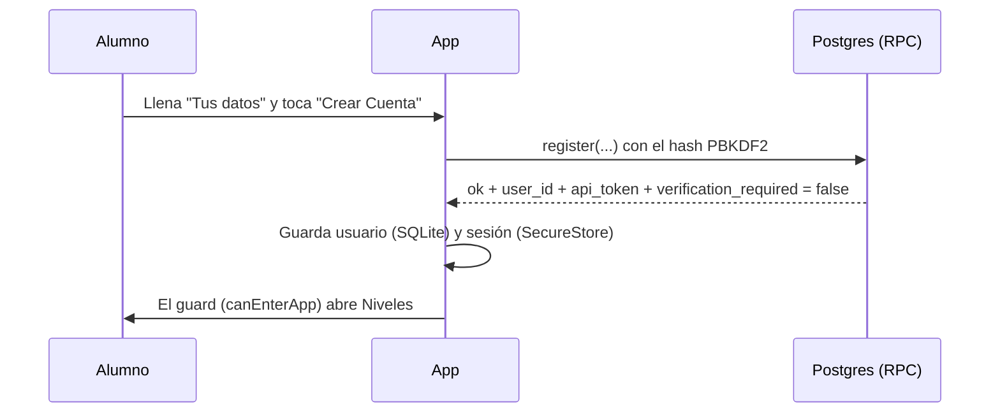

# 07 — Verificación de correo opcional (`auth`)

- **Estado:** implementada. La verificación está **apagada**: quien se registra entra directo al curso.
- **Fecha:** 17 de noviembre de 2026
- **Commit:** `80c55de FEAT: Verificacion de correo opcional (apagada) con interruptor en el servidor.`
- **Antecedentes:** `spec/05_auth_register_spec.md` (registro en 2 pasos) y la Edge Function
  `send-verification` (commit `48d16dd`, Gmail en la nube y Mailpit en local).
- **Código:**
  - Supabase: `supabase/migrations/20261117000100_optional_email_verification.sql`.
  - App: `src/core/session/` y `src/features/auth/`.

## 1. Motivo

Enviar el código con la API de Gmail resultó caro y difícil de configurar (proyecto en Google Cloud,
pantalla de consentimiento OAuth y refresh token). Mientras se elige otro proveedor (se planea **Resend**),
el registro no debe depender del correo: el alumno se registra con su correo y entra al curso.

La verificación no se borra, se vuelve **opcional**. La pantalla del código, las RPC `create_verification_code` y
`verify_email` y la Edge Function siguen en el proyecto, listas para encenderse.

## 2. Decisiones

| #   | Decisión                           | Resultado                                                                                                                                                                                                                                                                                                                      |
| --- | ---------------------------------- | ------------------------------------------------------------------------------------------------------------------------------------------------------------------------------------------------------------------------------------------------------------------------------------------------------------------------------ |
| V1  | Dónde vive el interruptor          | **En el servidor**: `private.settings.email_verification_required`, una sola fila, apagado por omisión. La app lo recibe en `register` y `login`. Así se enciende sin publicar otra versión de la app.                                                                                                                         |
| V2  | Correo ya registrado sin verificar | Con la verificación **apagada**, `register` responde siempre `email_taken`. Antes, una cuenta sin verificar se reemplazaba al registrarse de nuevo (registro abandonado). Sin verificación no hay forma de probar quién es el dueño del correo, así que permitirlo dejaría que cualquiera le quitara la cuenta a otra persona. |
| V3  | Ranking                            | Con la verificación apagada participan **todos**; encendida, solo los correos verificados (como antes).                                                                                                                                                                                                                        |
| V4  | Regla de entrada en la app         | Una sola función pura, `canEnterApp(session)`: entra quien verificó su correo **o** quien no necesita verificarlo. La usan el guard de navegación y `autoSync`.                                                                                                                                                                |
| V5  | Compatibilidad                     | Si el servidor no manda `verification_required` (nube sin la migración) o una sesión guardada no lo tiene, se toma `true`, que es el comportamiento anterior. Ningún teléfono ni servidor viejo deja entrar sin verificar por accidente.                                                                                       |
| V6  | Paso "Tus datos · Verificación"    | El indicador de pasos se quita del registro (el registro no sabe si habrá segundo paso hasta que responde el servidor) y solo se muestra en la pantalla del código. El botón pasa de "Crear Cuenta y Recibir Código" a "Crear Cuenta".                                                                                         |

## 3. Comportamiento según el interruptor

| Situación                           | Apagado (actual)                            | Encendido                                                         |
| ----------------------------------- | ------------------------------------------- | ----------------------------------------------------------------- |
| Registrarse                         | Entra directo a Niveles; no se envía código | Se envía el código y se abre "Verificación"                       |
| Registrarse con un correo ya usado  | "Este correo ya tiene una cuenta"           | Igual si está verificado; si no, reemplaza el registro abandonado |
| Iniciar sesión sin haber verificado | Entra al curso                              | Abre "Verificación"                                               |
| Ranking                             | Todos los participantes                     | Solo correos verificados                                          |
| Sincronizar el avance               | Funciona con cualquier sesión               | Solo con el correo verificado                                     |

Las sesiones ya abiertas conservan el valor que recibieron al registrarse o iniciar sesión. El cambio
aplica en el siguiente registro o inicio de sesión.

## 4. Cambios en Supabase

Migración nueva `20261117000100_optional_email_verification.sql` (no se edita ninguna existente):

- `private.settings (id boolean pk check (id), email_verification_required boolean default false)`, sin
  permisos para `anon` ni `authenticated`.
- `private.email_verification_required()`: lee el interruptor (`security definer`, `search_path = ''`).
- `public.register`: aplica V2 y su respuesta `ok` agrega `verification_required`.
- `public.login`: su respuesta agrega `verification_required`.
- `private.ranking`: `where p.email_verified or not private.email_verification_required()`.

Encender o apagar (Studio → SQL Editor, en local o en la nube):

```sql
select * from private.settings;
update private.settings set email_verification_required = true;   -- pedir el código
update private.settings set email_verification_required = false;  -- entrar sin código
```

## 5. Cambios en la app

```text
core/session/
├── SessionStore.ts          # Session.verificationRequired + canEnterApp()
└── SecureSessionStore.ts    # Zod: verificationRequired con default(true) para sesiones viejas
features/auth/
├── domain/ports/AuthRemote.ts                    # RegisterResponse y LoginResponse con verificationRequired
├── data/datasources/SupabaseAuthRemoteDataSource.ts  # DTO: verification_required con default(true)
├── domain/usecases/RegisterUserUseCase.ts        # guarda verificationRequired en la sesión
├── domain/usecases/LoginUseCase.ts               # ídem
└── presentation/
    ├── viewmodels/useRegisterViewModel.ts        # sin verificación: no pide código; el guard abre el curso
    ├── components/AuthLayout.tsx                 # el indicador de pasos solo con `step`
    └── screens/RegisterScreen.tsx                # botón "Crear Cuenta"
composition/
├── RootNavigator.tsx        # guard = canEnterApp(session)
└── autoSync.ts              # sincroniza si canEnterApp(session)
```

Flujo del registro con la verificación apagada:



## 6. Pruebas

| Dónde                                        | Qué se prueba                                                                                                                                           |
| -------------------------------------------- | ------------------------------------------------------------------------------------------------------------------------------------------------------- |
| `supabase/tests/register.test.sql`           | Encendida: el comportamiento original. Apagada: `verification_required = false`, un correo registrado no se reemplaza, `anon` no lee `private.settings` |
| `supabase/tests/login.test.sql`              | `login` devuelve `verification_required`                                                                                                                |
| `supabase/tests/ranking.test.sql`            | Encendida: los no verificados no aparecen. Apagada: aparecen todos                                                                                      |
| `SessionStore.test.ts`                       | `canEnterApp` en los tres casos (sin sesión, requerida, no requerida)                                                                                   |
| `SecureSessionStore.test.ts`                 | Una sesión guardada sin el campo se lee exigiendo verificación                                                                                          |
| `SupabaseAuthRemoteDataSource.test.ts`       | Sin el campo → `true`; con `false` → `false`                                                                                                            |
| `RegisterUserUseCase.test.ts`                | Sin verificación, la sesión ya permite entrar                                                                                                           |
| `RegisterScreen.test.tsx`                    | Sin verificación no pide código ni abre la verificación                                                                                                 |
| `RootNavigator.test.tsx`, `autoSync.test.ts` | Sin verificación entra al curso y sincroniza aunque el correo no esté verificado                                                                        |

Resultado al cerrar la etapa: Jest 367 pruebas (86 suites) y pgTAP 109 pruebas, todas en verde; typecheck y
lint limpios.

## 7. Pendientes

| Tema                          | Situación                                                                                                                                                               |
| ----------------------------- | ----------------------------------------------------------------------------------------------------------------------------------------------------------------------- |
| Subir a la nube               | `npx supabase db push` (lo decide el usuario). Mientras la nube no tenga la migración, la app nueva sigue pidiendo el código (V5).                                      |
| Proveedor de correo (Resend)  | Agregar la estrategia en `supabase/functions/send-verification/mailer.ts` (hoy: Gmail o Mailpit), su secreto con `npx supabase secrets set`, y encender el interruptor. |
| Cuentas creadas sin verificar | Al encender la verificación, quienes se registraron sin verificar tendrán que validar su correo en su siguiente inicio de sesión.                                       |
| Correos falsos o ajenos       | Con la verificación apagada, alguien puede registrarse con un correo que no es suyo. Aceptado mientras no haya proveedor; se corrige al encenderla.                     |
